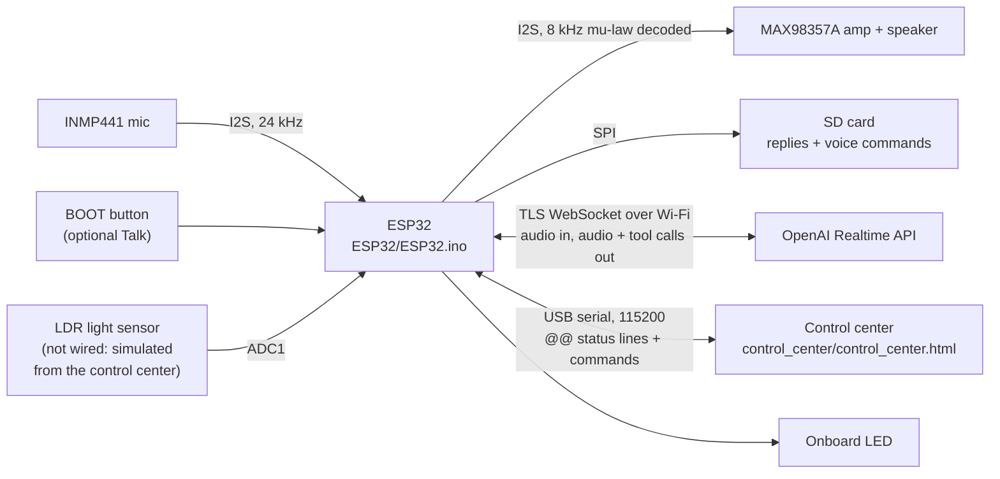
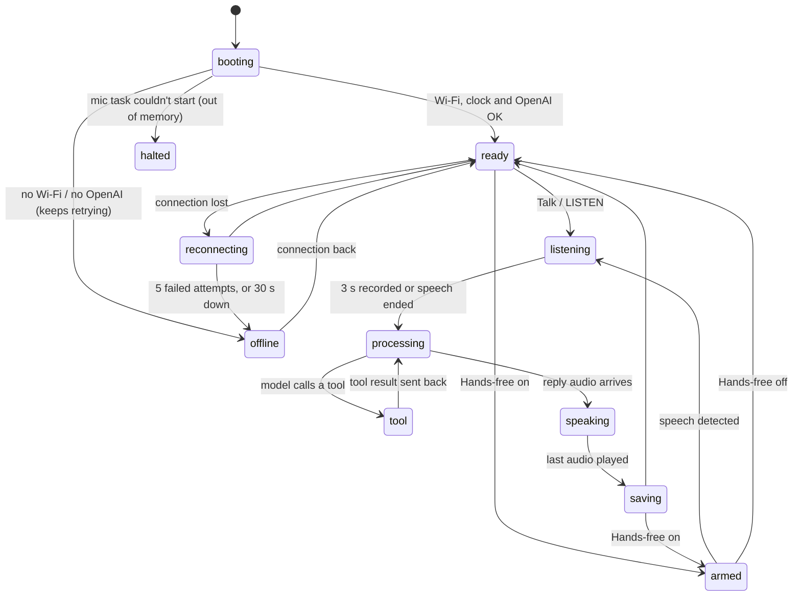
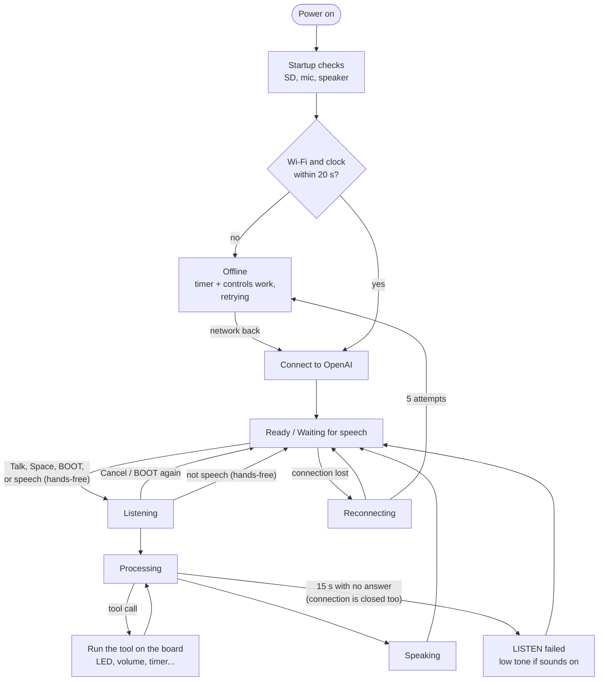

# איך הקוד בנוי - עוזר קולי על ESP32

קבוצה A2, קורס IoT, קיץ 2026. המסמך הזה מסביר את הקוד: מה כל חלק עושה, איך הלוח עובר בין מצבים, ואיך מרכז הבקרה יודע מה קורה בלוח. איך זה עובד מבחוץ מוסבר ב-[README](../README.md).

## התמונה הגדולה

ה-ESP32 לא מבין דיבור בעצמו. הוא מקליט, שולח, מנגן ומבצע. כל ההבנה קורית אצל OpenAI, שמחזיר אודיו ולפעמים גם בקשה להפעיל "כלי" בלוח.

## המודולים

כל מודול הוא זוג קבצים `xxx_utils.h/.cpp` בתיקייה `ESP32/`, עם namespace משלו (`esp32va_...`). הקובץ `ESP32.ino` מחבר את כולם: הוא מחזיק את מצב השיחה ומחליט מה לעשות בכל רגע. הגישה לכל רכיב חומרה מרוכזת במודול אחד: I2S רק ב-`i2s_audio_utils`, ה-LED רק ב-`board_state_utils`, ה-SD רק במודולי ה-SD, הכפתור רק ב-`button_utils`.

שני קבצים בלי קוד: `parameters.h` (כל הפרמטרים הקבועים - ראו [Parameters/parameters.md](../Parameters/parameters.md)) ו-`SECRETS.h` (סיסמת ה-Wi-Fi ומפתח ה-API, לא בגיט; התבנית היא `SECRETS.example.h`).

| מודול | מה הוא עושה |
|---|---|
| `ESP32.ino` | הלולאה הראשית, מצב השיחה, הטיפול באירועים של OpenAI והפעלת הכלים |
| `wifi_utils` | Wi-Fi ושעון: התחברות בלי להיתקע, הרשת השמורה ב-flash (או זו של `SECRETS.h`; אם הרשת השמורה נכשלת שוב ושוב חוזרים לזו של `SECRETS.h`), פקודות `WIFI_*`, וסנכרון השעה לפי שעון ישראל כולל שעון קיץ |
| `openai_realtime_utils` | החיבור המאובטח ל-OpenAI, אימות, פעימת לב (ping כל 15 שניות) שמגלה חיבור מת, התחברות מחדש עם המתנה שגדלה, ומצב offline (אף פעם לא מוותר) |
| `realtime_json_utils` | סריקה מהירה של הודעות גדולות מהשרת בלי לפענח את כל ה-JSON |
| `i2s_audio_utils` | המיקרופון והרמקול (I2S), ה-ring buffer של הניגון ופענוח mu-law |
| `mic_capture_utils` | משימה נפרדת (FreeRTOS) שקוראת את המיקרופון בלי הפסקה |
| `vad_utils` | גלאי הקול: מחליט מתי מישהו התחיל ומתי סיים לדבר |
| `hands_free_utils` | מצב Hands-free: מקשיב לבד כשהלוח פנוי ושולח רק דיבור אמיתי |
| `board_state_utils` | ה-LED (כולל בהירות) והכלי `set_board_state` |
| `light_sensor_utils` | חיישן האור (בגרסת ההגשה הערך מדומה ממרכז הבקרה, כי ה-LDR לא מחובר; LDR אמיתי נקרא כשמגדירים `LIGHT_SENSOR_PIN`) והכלי `get_time_of_day` |
| `device_controls_utils` | פקודות עוצמה, השתקה, צפצוף ו-LED מהמחשב, צלילי המצב (`SOUNDS`), והכלי `set_volume` |
| `button_utils` | כפתור BOOT ככפתור Talk פיזי (כבוי כברירת מחדל, `BUTTON on`), עם debounce |
| `clock_timer_utils` | הכלים `get_current_time` ו-`set_timer`, הצלצול של הטיימר, וההודעה בקול כשהוא נגמר |
| `board_info_utils` | הכלי `get_board_status`: עוצמת ה-Wi-Fi, זמן מההדלקה וזיכרון פנוי |
| `greeting_utils` | משפט פתיחה אקראי כשהחיבור מוכן |
| `settings_store_utils` | שמירת הגדרות בזיכרון הקבוע (NVS), כך שהן נשארות אחרי כיבוי |
| `sd_card_utils` | חיבור כרטיס ה-SD, בדיקה שהוא באמת כותב וקורא, וסימון אם יש כרטיס תקין (בלעדיו הלוח ממשיך בלי הקלטות) |
| `recording_folder_utils` | שמות הקבצים והתיקיות של ההקלטות |
| `reply_recorder_utils` | שומר כל תשובה של העוזר ל-SD בזמן שהיא מגיעה |
| `voice_command_recorder_utils` | שומר את מה שהמיקרופון שמע בכל פקודה |
| `sd_file_transfer_utils` | פקודות LIST / GET / DELETE: מרכז הבקרה מוריד הקלטות מהלוח |
| `status_report_utils` | שורות ה-`@@` למרכז הבקרה |
| `measurement_utils` | מדידות זמן (עלייה ותגובה) לכל פקודה |
| `heap_diagnostics_utils` | מדידות זיכרון בכל שלב |
| `log_utils` | מאקרו לוג עם רמות (`LOG_INFO`, `LOG_ERROR`, ...) |

## מה קורה בלולאה הראשית

הפונקציה `loop()` רצה כל הזמן ולא נתקעת באף שלב. בכל סיבוב היא:

1. מקבלת הודעות מ-OpenAI (אלא אם ה-buffer של הרמקול כמעט מלא, ואז עוצרת קצת כדי שהניגון יתפוס).
2. בודקת אם הוקלד משהו ב-Serial (מהמחשב או ממרכז הבקרה).
3. שולחת ל-OpenAI את חתיכות המיקרופון שמוכנות.
4. בודקת אם הניגון הסתיים, ואם עבר יותר מדי זמן בלי תשובה.
5. נותנת ל-Hands-free להחליט אם להתחיל להקליט, ולטיימר אם לצלצל.
6. בודקת את כפתור BOOT (אם הודלק) ומנגנת צליל מצב שמחכה (אם הודלקו), רק כשהלוח שקט.
7. שומרת על ה-Wi-Fi (ומתחילה מחדש אם הוא למטה דקה אחרי הניסיון האחרון), ופותחת את החיבור ל-OpenAI ברגע שיש רשת ושעון. כש-Wi-Fi חוזר אחרי הפסקה, ההמתנה בין הניסיונות מתאפסת וה-OpenAI מתחבר מחדש תוך שניות, בלי לחכות את ה-30 שניות של מצב offline.
8. מחשבת את המצב של העוזר ומדווחת למרכז הבקרה אם הוא השתנה.

`setup()` לא מחכה לנצח לאף דבר: Wi-Fi עד 20 שניות, שעון עד 15. בלעדיהם הלוח ממשיך במצב offline, והפקודות, הטיימר והפקדים עובדים.

## המצבים של העוזר

הלוח מדווח כל שינוי מצב בשורה `@@STATE`. מרכז הבקרה צובע לפיה את העיגול הגדול.

| מצב | מה הלוח עושה |
|---|---|
| `booting` | בודק את החומרה ומתחבר. כל בדיקה מדווחת בשורת `@@STAGE` |
| `ready` | מחכה ל-Talk |
| `armed` | Hands-free דלוק: מקשיב לרעש ומחכה לדיבור |
| `listening` | מקליט ושולח ל-OpenAI |
| `processing` | ההקלטה נגמרה, מחכה לתשובה |
| `tool` | מבצע כלי (למשל מדליק LED). הפרטים אומרים איזה |
| `speaking` | מנגן את התשובה. הפרטים `greeting`, `timer` או `typed` כשהוא עונה בלי הקלטה, וגם בין הבקשה לתשובה כזו לבין תחילת הקול שלה. בזמן הזה Talk נדחה |
| `saving` | מסיים לשמור את התשובה ל-SD |
| `reconnecting` | החיבור ל-OpenAI נפל ומתחבר מחדש |
| `offline` | אין Wi-Fi או אין OpenAI (גם כשיש Wi-Fi בלי אינטרנט, ואז נורית OpenAI אדומה). ממשיך לנסות כל 30 שניות, ומיד כש-Wi-Fi חוזר; הטיימר והפקדים עובדים. הפרטים אומרים `no Wi-Fi` או `OpenAI unreachable` |
| `halted` | נעצר: משימת המיקרופון לא עלתה (חוסר זיכרון בהדלקה). המצב היחיד שדורש Reset |

### איך המצב מחושב (מכונת המצבים)

הלוגיקה של השיחה מחזיקה דגלים, אחד לכל מקור של אירועים: ההקלטה (`is_capturing`), השאלה שמחכה לתשובה (`awaiting_reply`), תשובה שעוד לא הסתיימה בשרת (`response_in_flight`), ניגון (`speech_in_progress`), וכלי (`function_call_turn_pending`). הפונקציה `updatePipelineState()` ב-`ESP32.ino` היא המקום היחיד שמחליט מה המצב, בסדר עדיפויות קבוע:

| עדיפות | תנאי | מצב |
|---|---|---|
| 1 | נעצר | `halted` |
| 2 | אין סשן, ו-(אין Wi-Fi, או 5 ניסיונות, או 30 שניות בלי חיבור) | `offline` |
| 3 | אין סשן, עוד לא היה חיבור | `booting` |
| 4 | אין סשן, היה חיבור | `reconnecting` |
| 5 | כלי באמצע | `tool` |
| 6 | מנגן | `speaking` |
| 7 | מקליט | `listening` |
| 8 | מחכה לתשובה | `processing` |
| 9 | ביקש ברכה, הודעת טיימר או תשובה לשאלה בכתב, והקול שלה עוד לא התחיל | `speaking` |
| 10 | שומר תשובה ל-SD | `saving` |
| 11 | Hands-free מחכה לדיבור | `armed` |
| 12 | אחרת | `ready` |

הסיבה לדגלים ולא ל-enum עם מעברים מתועדת ב-[decisions.md](decisions.md).

## זרימת השימוש

אין מצב "תקוע": כל מצב שמחכה לשרת נגמר אחרי 15 שניות של שקט (והחיבור נסגר, כדי שיתחבר מחדש או יעבור ל-offline), פעימת הלב מגלה חיבור מת גם בלי שאלה פתוחה, ו-Cancel (או כפתור BOOT) מבטל הקלטה או תשובה בכל רגע. Talk נדחה כל עוד העוזר עונה (למשל ברכה או הודעת טיימר), כדי לא לשבש אותה.

## הפרוטוקול בין הלוח למרכז הבקרה

הלוח מדפיס ל-Serial שני סוגי שורות: לוג רגיל לבני אדם, ושורות שמתחילות ב-`@@` בשביל מרכז הבקרה. כך מרכז הבקרה לא צריך לנחש מתוך הלוג. כל שורה היא מילה אחרי `@@` ואז הפרטים, מופרדים ברווחים. הפקודה `STATUS` מדפיסה מחדש את כל המצב, וכך מרכז הבקרה מתעדכן גם אם התחבר באמצע.

### שורות סטטוס (מהלוח)

| שורה | דוגמה | מה היא אומרת |
|---|---|---|
| `@@STAGE` | `@@STAGE wifi ok <board-ip>` | תוצאה של בדיקת עלייה: sd, mic, speaker, wifi, time, openai |
| `@@STATE` | `@@STATE tool set_volume` | המצב של העוזר (הטבלה למעלה) |
| `@@HEARD` | `@@HEARD Turn on the light.` | מה שהמשתמש אמר, בטקסט |
| `@@SAID` | `@@SAID Done, the light is on.` | מה שהעוזר ענה, בטקסט |
| `@@RESULT` | `@@RESULT pass 4` | האם הפקודה ה-4 הצליחה, ואם לא, למה |
| `@@MIC_LEVEL` | `@@MIC_LEVEL -32` | עוצמת המיקרופון בזמן הקלטה (dBFS), 10 פעמים בשנייה |
| `@@WIFI` | `@@WIFI -58` | עוצמת ה-Wi-Fi |
| `@@LED` | `@@LED on 100 voice` | מצב ה-LED, הבהירות, ומי שינה אותו: `voice` (קול), `gui` (מרכז הבקרה) או `status` (הדפסה מחדש בתשובה ל-`STATUS`) |
| `@@VOLUME` | `@@VOLUME 30 unmuted` | עוצמת הרמקול והאם מושתק |
| `@@BEEP` | `@@BEEP played` | צפצוף הבדיקה נוגן, או `busy` |
| `@@LIGHT` | `@@LIGHT 4000 day 1000 3000` | קריאת חיישן האור, חלק היום והספים |
| `@@TIMER` | `@@TIMER 45 60 check the oven` | 45 מתוך 60 שניות נשארו, ועל מה התזכורת (אם יש). גם `off`, ו-`done` כשהוא מצלצל |
| `@@CLOCK` | `@@CLOCK 14:05 1792235100` | השעה המקומית של הלוח (ו-Unix time). `unset` אם השעון לא סונכרן. ה-Self-test משווה אותה לשעה במחשב |
| `@@VAD` | `@@VAD on 3 900` | Hands-free דלוק או כבוי, רגישות (1-5) וכמה מילישניות שקט מסיימות משפט |
| `@@VAD_LEVEL` | `@@VAD_LEVEL -48 -55 -40` | הרעש עכשיו, רעש הרקע והסף, בזמן ש-Hands-free מקשיב |
| `@@VAD_EVENT` | `@@VAD_EVENT discarded short 180` | דיבור התחיל (`started`), נשלח (`sent`), נזרק כי לא נשמע כמו דיבור (`discarded short\|unvoiced\|steady`), או השהיה אחרי הרבה רעש (`paused`) |
| `@@TIMING` | `@@TIMING n=4 result=pass ...` | הזמנים של פקודה אחת, לגרף ולטבלת המדידות |
| `@@BOOT_TIMING` | `@@BOOT_TIMING ... total_ms=6120` | כמה זמן לקח כל שלב בעלייה |
| `@@HEAP` | `@@HEAP free=139900 largest=110580 ...` | הזיכרון הפנוי אחרי כל שלב |
| `@@WIFI_NET` | `@@WIFI_NET saved <hotspot>` | איזו רשת הלוח משתמש בה: `saved` (נשמרה ממרכז הבקרה) או `default` (מ-`SECRETS.h`). אף פעם לא הסיסמה |
| `@@BUTTON` | `@@BUTTON off` | האם כפתור BOOT משמש ככפתור Talk |
| `@@SOUNDS` | `@@SOUNDS on` | האם צלילי המצב מודלקים |

### שורות של העברת קבצים (מהלוח)

`@@LIST_BEGIN`, `@@FILE <name> <size>`, `@@LIST_END <count>` עונות ל-`LIST`. ‏`@@GET_BEGIN <name> <size>`, ואחריה הבייטים עצמם, ואז `@@GET_END <name> <crc32>` עונות ל-`GET`. מרכז הבקרה בודק את ה-CRC כדי לדעת שהקובץ הגיע שלם. ‏`@@SAVED` ו-`@@DELETED` אומרות שהקלטה נוספה או נמחקה. ‏`@@BUSY` אומרת שהלוח באמצע שיחה ולא יכול לשלוח קובץ עכשיו. ‏`@@GET_ERROR`, `@@DELETE_ERROR` ו-`@@DELETE_ALL_ERROR` אומרות שהפקודה נכשלה (למשל אין קובץ כזה), ו-`@@DELETE_ALL_DONE` שהמחיקה של תיקייה שלמה הסתיימה.

### פקודות (מהמחשב ללוח)

אפשר להקליד אותן גם ב-Serial Monitor של Arduino. מרכז הבקרה שולח את אותן פקודות.

| פקודה | מה היא עושה |
|---|---|
| `LISTEN` | מקליט 3 שניות ושולח (כמו הכפתור Talk) |
| `CANCEL` | מבטל את ההקלטה או התשובה שבאמצע |
| `ASK <text>` | שולח שאלה כתובה, עד 200 בייטים (כ-100 אותיות בעברית, או 200 באנגלית; מה שארוך יותר נחתך). התשובה נאמרת בקול כרגיל, בלי הקלטה ובלי `@@TIMING`. הלוח מחזיר את הטקסט כ-`@@HEARD` |
| `STATUS` | מדפיס מחדש את כל שורות הסטטוס |
| `CLOCK` | מדפיס רק את `@@CLOCK` |
| `VOLUME <0-100>`, `MUTE on\|off`, `BEEP` | הרמקול |
| `SOUNDS on\|off` | צלילי מצב |
| `BUTTON on\|off` | כפתור BOOT ככפתור Talk |
| `WIFI`, `WIFI_SSID <name>`, `WIFI_PASSWORD [<password>]`, `WIFI_FORGET` | הרשת: מה בשימוש, שמירת רשת חדשה (השם, ואז הסיסמה, שמירה והתחברות), חזרה לברירת המחדל |
| `LED on\|off`, `LED_BRIGHTNESS <0-100>` | ה-LED |
| `LIGHT <0-6142>`, `LIGHT_BANDS <evening> <day>` | חיישן האור המדומה והספים שלו |
| `VAD on\|off`, `VAD_SENSITIVITY <1-5>`, `VAD_HANGOVER <600-1500>` | Hands-free |
| `LIST`, `GET <name>`, `DELETE <name>`, `DELETE_ALL [replies\|commands]` | ההקלטות ב-SD |

## כלי חדש בשלושה צעדים

ככה הוספנו את `set_volume`, `get_current_time`, `set_timer` ו-`get_board_status`:

1. מוסיפים את הכלי לרשימת הכלים בהודעת ההגדרות של הסשן (`kSessionUpdateMessage` ב-`ESP32.ino`): שם, תיאור באנגלית למודל, וסכמת JSON של הפרמטרים.
2. כותבים פונקציה במודול המתאים שקוראת את הפרמטרים, מבצעת, מדפיסה שורת `@@` ושולחת ל-OpenAI את התוצאה (`function_call_output`) ובקשה לענות (`response.create`).
3. מוסיפים את שם הכלי ל-dispatch ב-`ESP32.ino`. אם צריך, מלמדים את מרכז הבקרה את שורת ה-`@@` החדשה.

## זיכרון

ל-ESP32-WROOM-32 שלנו אין PSRAM. בהדלקה פנויים כ-215KB, וכשהסשן מוכן נשארים רק כ-38KB, כי החיבור המוצפן וה-WebSocket לבדם לוקחים כ-51KB. לכן לא שומרים הקלטה שלמה בזיכרון אלא שולחים כל 100ms מיד, מבקשים מ-OpenAI תשובה ב-mu-law ‏8kHz (קטנה פי 6), ומודדים את הזיכרון אחרי כל שלב (`@@HEAP`). הפירוט והמספרים ב-[README](../README.md), בחלק של המדידות.

