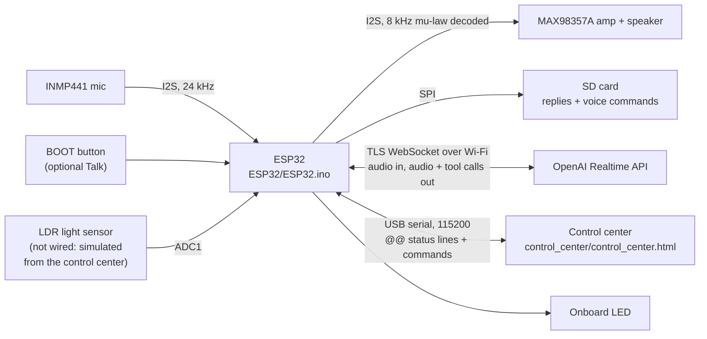
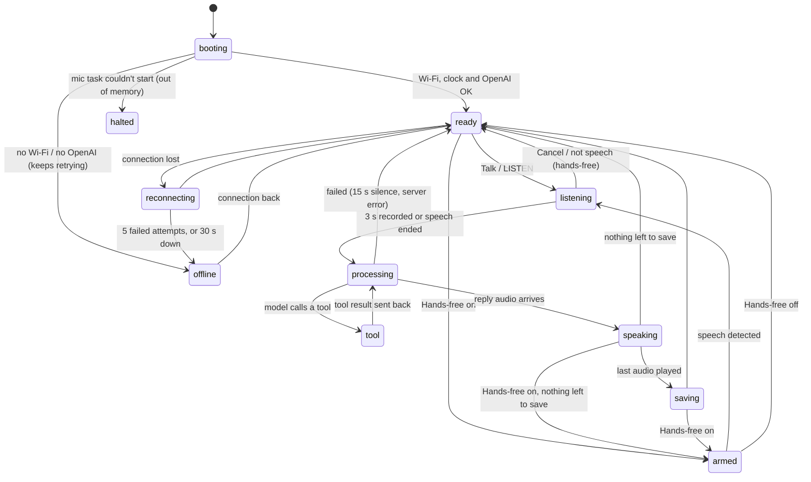

## How it works

1. A separate task (FreeRTOS) reads the microphone at 24kHz every 20ms, even when the main loop is busy.
2. Every 100ms of audio is sent right away over a single encrypted WebSocket connection to OpenAI. We do not wait for the end of the recording, because 3 seconds of raw audio do not even fit in the free memory.
3. The model answers with mu-law audio at 8kHz (6 times smaller than PCM at 24kHz). The ESP32 decodes and plays it.
4. When the model wants to do something on the board, it calls a "tool" with a JSON schema. The ESP32 carries it out and returns a result, and the model says what was done.
5. The board constantly prints `@@...` lines to Serial, and the control center reads them ([the protocol](Documentation/architecture.md)).

### The tools the model can call

| Tool | What it does | Example |
|---|---|---|
| `set_board_state` | Turns the LED on or off, and can also set the brightness | `Turn on the light`, `Dim the light to 30 percent` |
| `get_time_of_day` | Reads the light sensor (simulated from the control center) and returns day, evening or night | `Is it day or night?` |
| `set_volume` | Sets the volume in percent (10-100), or raises / lowers it by 20% | `Set the volume to 30 percent`, `Louder` |
| `get_current_time` | The date and time from the board's clock (synchronized from the internet, in Israel time including daylight saving time), and how much time is left on the timer | `What time is it?` |
| `get_board_status` | The Wi-Fi signal strength, how many minutes the board has been on and how much memory is free | `How are you doing?` |
| `set_hands_free` | Turns Hands-free on or off, exactly like the switch in the control center. Only when the current question explicitly asks for it: a question about the mode, or a passing mention of a button, changes nothing | `Switch to hands-free mode`, `I want to talk without pressing a button`, `Disable VAD` |
| `set_timer` | A timer of 1 to 3600 seconds (20 to 60 seconds in the demo), or a cancel (0). Above an hour, it sets one hour and the assistant says so. A negative value or one shorter than a second is rejected, and the assistant asks again without touching the running timer. At the end the assistant says so out loud (including what the reminder is about), and it can turn the light on or off | `Remind me in 30 seconds to check the oven`, `Turn off the light in 20 seconds` |

# How the Code Is Built - Voice Assistant on ESP32

Group A2, IoT course, Summer 2026. This document explains the code: what each part does, how the board moves between states, and how the control center knows what is happening on the board. How it works from the outside is explained in the [README](../README.md).

## The big picture

The ESP32 does not understand speech by itself. It records, sends, plays and carries out actions. All the understanding happens at OpenAI, which returns audio and sometimes also a request to run a "tool" on the board.

## The modules

Each module is a pair of files `xxx_utils.h/.cpp` in the `ESP32/` folder, with its own namespace (`esp32va_...`). The sketch `ESP32.ino` connects them all: it holds the conversation state and decides what to do at each moment. It is split into Arduino tabs, which the Arduino IDE joins into one file when compiling. Access to each hardware component is concentrated in one module: I2S only in `i2s_audio_utils`, the LED only in `board_state_utils`, the SD card only in the SD modules, the button only in `button_utils`.

Each module is a single object: its internal state is in the `.cpp` file (private), and the `.h` file is the interface. Why a namespace and not a class is explained in [decisions.md](decisions.md). Which hardware component belongs to which module:

| Hardware | The module | The namespace |
|---|---|---|
| The LED on the board (GPIO 2, brightness via PWM) | `board_state_utils` | `esp32va_board` |
| Speaker + MAX98357A amplifier and INMP441 microphone (one I2S port) | `i2s_audio_utils`. Reading the microphone in a separate task: `mic_capture_utils`. The voice detector: `vad_utils` | `esp32va_audio`, `esp32va_mic_capture`, `esp32va_vad` |
| Volume, mute and beep | `device_controls_utils` | `esp32va_controls` |
| BOOT button (GPIO 0) | `button_utils` | `esp32va_button` |
| LDR light sensor (simulated from the control center; the ADC reading is ready) | `light_sensor_utils` | `esp32va_light_sensor` |
| SD card (SPI) | `sd_card_utils`. Saving and transferring the recordings: `reply_recorder_utils`, `voice_command_recorder_utils`, `sd_file_transfer_utils` | `esp32va_sd_card`, `esp32va_reply_recorder`, `esp32va_command_recorder`, `esp32va_sd_transfer` |
| Wi-Fi and the clock | `wifi_utils` | `esp32va_wifi` |
| Non-volatile memory (NVS) | `settings_store_utils` | `esp32va_settings` |

Three files without code: `parameters.h` (all the fixed parameters - see [Parameters/parameters.md](../Parameters/parameters.md)), `realtime_session_config.h` (the session configuration message: the instructions for the model and the list of tools) and `SECRETS.h` (the default Wi-Fi network and API key - both can be replaced from the control center; not in git, the template is `SECRETS.example.h`).

| Module | What it does |
|---|---|
| `ESP32.ino` | The includes, the shared conversation-state flags, declarations of all the functions in the tabs, and `setup()`/`loop()` |
| `listen_turn.ino` | A question (LISTEN): a manual or voice start, sending the microphone to OpenAI, ending, canceling, and a typed question (`ASK`) |
| `server_events.ino` | The WebSocket events and all the server messages: the session, the answer's audio and text, tool calls (dispatch), the end of an answer and errors |
| `serial_commands.ino` | The commands from Serial (from the control center) and the BOOT button: Talk, the rejection tone and the technician check |
| `state_machine.ino` | The state machine: the transitions (a named function for each transition), `updatePipelineState()` which derives the state (`@@STATE`), and the timeout, offline and connection checks |
| `verdicts.ino` | PASSED/FAILED for each question and for the step, halting, the recording measurements and the recordings on the SD card |
| `wifi_utils` | Wi-Fi and the clock: connecting without getting stuck, the network saved in flash (or the one from `SECRETS.h`; if the saved network fails twice in a row it switches to the one from `SECRETS.h`, and back the same way), the `WIFI_*` commands, and synchronizing the time to Israel time including daylight saving time |
| `openai_realtime_utils` | The secure connection to OpenAI, authentication, a heartbeat (a ping every 15 seconds; two pongs in a row that did not come back within 10 seconds close the connection) that detects a dead connection, reconnecting with a growing wait, and offline mode (it never gives up). The API key: the one saved in flash (or the one from `SECRETS.h`; if OpenAI refuses the saved one twice in a row, HTTP 401/403, it switches to the one from `SECRETS.h`, and back the same way) and the `OPENAI_KEY*` commands. Also sending a tool's result (`sendFunctionCallOutput`) |
| `realtime_json_utils` | Fast scanning of large messages from the server without parsing the whole JSON |
| `i2s_audio_utils` | The microphone and the speaker (I2S), the playback ring buffer and mu-law decoding |
| `mic_capture_utils` | A separate task (FreeRTOS) that reads the microphone without a break |
| `vad_utils` | The voice detector: decides when someone started and when they finished speaking |
| `hands_free_utils` | Hands-free mode: listens on its own when the board is free and sends only real speech. Also the `set_hands_free` tool (turning it on and off by voice), and `LAPTOP_PLAYBACK`: does not listen while the control center plays a recording on the computer's speakers |
| `board_state_utils` | The LED (including brightness) and the `set_board_state` tool |
| `light_sensor_utils` | The light sensor (in the submission version the value is simulated from the control center, because the LDR is not connected; a real LDR is read when `LIGHT_SENSOR_PIN` is defined) and the `get_time_of_day` tool |
| `device_controls_utils` | The volume, mute, beep and LED commands from the computer, the status sounds (`SOUNDS`), and the `set_volume` tool |
| `button_utils` | The BOOT button as a physical Talk button (off by default, `BUTTON on`), with debounce. A long press (2 seconds) runs a technician check, see "The BOOT button: sounds and technician check" |
| `clock_timer_utils` | The `get_current_time` and `set_timer` tools, the timer's ring, and the spoken message when it ends |
| `board_info_utils` | The `get_board_status` tool: the Wi-Fi signal strength, the time since boot and the free memory |
| `greeting_utils` | A random opening sentence when the connection is ready |
| `settings_store_utils` | Saving settings in non-volatile memory (NVS), so they stay after power off |
| `sd_card_utils` | Mounting the SD card, checking that it really writes and reads, and marking whether there is a working card (without one the board continues without recordings). A card pulled out while running is detected when opening or writing a recording fails: at the next free moment the board checks it, and if it does not answer the SD light turns red and the board behaves as after a boot without a card, until a Reset |
| `recording_folder_utils` | The file and folder names of the recordings |
| `reply_recorder_utils` | Saves each of the assistant's answers to the SD card as it arrives |
| `voice_command_recorder_utils` | Saves what the microphone heard in each command |
| `sd_file_transfer_utils` | The LIST / GET / DELETE commands: the control center downloads recordings from the board |
| `status_report_utils` | The `@@` lines for the control center |
| `measurement_utils` | Time measurements (boot and response) for each command |
| `heap_diagnostics_utils` | Memory measurements at each stage |
| `log_utils` | Log macros with levels (`LOG_INFO`, `LOG_ERROR`, ...) |
| `command_parse_utils` | Shared helpers for Serial commands: separating the command word from the argument (`commandArgument`) and reading on/off |

## What happens in the main loop

The `loop()` function runs all the time and does not get stuck at any stage, except for downloading a recording (`GET`): it holds `loop()` for the whole transfer on purpose, because nothing may get mixed in between the file's bytes (about 3 seconds for an answer, up to about 40 seconds for a 10-second voice command in Hands-free). Hands-free is paused before that, and the control center locks Talk and Ask and shows "Downloading…" during that time (see [decisions.md](decisions.md)). In each normal iteration it:

1. Receives messages from OpenAI (unless the speaker buffer is almost full, and then it pauses a little so the playback catches up).
2. Checks whether something was typed on Serial (from the computer or from the control center).
3. Sends the microphone chunks that are ready to OpenAI.
4. Checks whether the playback has finished, and whether too much time has passed without an answer.
5. Lets Hands-free decide whether to start recording, and the timer whether to ring.
6. Checks the BOOT button (if turned on) and plays a pending status sound (if turned on), only when the board is quiet.
7. Keeps the Wi-Fi up (a new connection attempt every few seconds while it is down - the board does this itself, not the ESP32 core), and opens the connection to OpenAI as soon as there is a network and a clock. When the Wi-Fi comes back after an outage (or the network was changed), the wait between attempts resets and OpenAI reconnects within seconds (about 1-3), without waiting the 30 seconds of offline mode. If it still does not answer after 10 seconds, it goes back to retrying every 30 seconds. During this time the OpenAI light is orange (`Wi-Fi is back - reconnecting`), and red when the board is offline (`offline - retrying every 30 s`).
8. Computes the assistant's state and reports it to the control center if it changed, and prints `@@ALIVE` every 5 seconds.

`setup()` does not wait forever for anything: Wi-Fi up to 20 seconds, the clock up to 15. Without them the board continues in offline mode, and the commands, the timer and the controls work.

## The assistant's states

The board reports every state change in a `@@STATE` line. The control center colors the big circle according to it.

| State | What the board is doing |
|---|---|
| `booting` | Checking the hardware and connecting. Each check is reported in a `@@STAGE` line |
| `ready` | Waiting for Talk |
| `armed` | Hands-free is on: listening to the noise and waiting for speech |
| `listening` | Recording and sending to OpenAI |
| `processing` | The recording has ended, waiting for the answer |
| `tool` | Running a tool (for example turning on the LED). The details say which one. The state also ends when the question failed or the connection dropped, and does not get stuck |
| `speaking` | Playing the answer. The details are `greeting`, `timer` or `typed` when it answers without a recording, also between the request for such an answer and the start of its audio. During this time Talk is rejected |
| `saving` | Finishing saving the answer to the SD card |
| `reconnecting` | The connection to OpenAI dropped and it is reconnecting |
| `offline` | No Wi-Fi or no OpenAI (also when there is Wi-Fi without internet, and then the OpenAI light is red). It keeps retrying every 30 seconds; with no Wi-Fi it does not try OpenAI at all, and reconnects immediately when the Wi-Fi comes back (every second for 10 seconds); the timer and the controls work. The details say `no Wi-Fi` or `OpenAI unreachable` |
| `halted` | Stopped: the microphone task did not start (out of memory at boot). The only state that requires a Reset |

### How the state is computed (the state machine)

The conversation logic keeps flags, one for each source of events: the recording (`is_capturing`), the question waiting for an answer (`awaiting_reply`), an answer that has not finished on the server yet (`response_in_flight`), playback (`speech_in_progress`), and a tool (`function_call_turn_pending`). The `updatePipelineState()` function in `state_machine.ino` is the only place that decides what the state is, by a fixed order of priority:

| Priority | Condition | State |
|---|---|---|
| 1 | Halted | `halted` |
| 2 | No session, and (no Wi-Fi, or 5 attempts, or 30 seconds without a connection) | `offline` |
| 3 | No session, there has not been a connection yet | `booting` |
| 4 | No session, there was a connection | `reconnecting` |
| 5 | A tool in progress | `tool` |
| 6 | Playing | `speaking` |
| 7 | Recording | `listening` |
| 8 | Waiting for an answer | `processing` |
| 9 | Requested a greeting, a timer message or an answer to a typed question, and its audio has not started yet | `speaking` |
| 10 | Saving an answer to the SD card | `saving` |
| 11 | Hands-free waiting for speech | `armed` |
| 12 | Otherwise | `ready` |

The reason for flags rather than an enum with transitions is documented in [decisions.md](decisions.md).

## The usage flow

There is no "stuck" state: every state that waits for the server ends after 15 seconds of silence (and the connection is closed, so it reconnects or goes offline), the heartbeat detects a dead connection even with no open question, and Cancel (or the BOOT button) cancels a recording or an answer at any moment. Talk, LISTEN and BOOT are rejected as long as the assistant is answering (for example a greeting, a timer message or an answer to a typed question), so as not to disrupt it, and the state at that time is `speaking`. An error from the server sends Hands-free back to listening immediately, without waiting 15 seconds, and a connection drop in the middle of a question fails only that question (`LISTEN #N FAILED`), with no `HANDS-FREE FAILED` verdict.

## The protocol between the board and the control center

The board prints two kinds of lines to Serial: a regular log for humans, and lines that start with `@@` for the control center. That way the control center does not need to guess from the log. Each line is a word after `@@` and then the details, separated by spaces. The `STATUS` command prints the whole state again, so the control center gets up to date even if it connected in the middle. Replay plays the same lines: the control center reads a saved log (also one from `tools/serial_logger.ps1`) as if the board were connected, and such lines do not go into the live statistics or into the saved log. The board works only at 115200 baud.

### Status lines (from the board)

| Line | Example | What it says |
|---|---|---|
| `@@STAGE` | `@@STAGE wifi ok <board-ip>` | The result of a startup check: sd, mic, speaker, wifi, time, openai |
| `@@STATE` | `@@STATE tool set_volume` | The assistant's state (the table above) |
| `@@HEARD` | `@@HEARD Turn on the light.` | What the user said, as text |
| `@@SAID` | `@@SAID Done, the light is on.` | What the assistant answered, as text |
| `@@RESULT` | `@@RESULT pass 4` | Whether command 4 succeeded, and if not, why |
| `@@MIC_LEVEL` | `@@MIC_LEVEL -32` | The microphone level while recording (dBFS), 10 times a second |
| `@@WIFI` | `@@WIFI -58` | The Wi-Fi signal strength |
| `@@LED` | `@@LED on 100 voice` | The LED state, the brightness, and who changed it: `voice`, `gui` (the control center) or `status` (reprinted in answer to `STATUS`) |
| `@@VOLUME` | `@@VOLUME 30 unmuted` | The speaker volume and whether it is muted |
| `@@BEEP` | `@@BEEP played` | The test beep was played, or `busy` |
| `@@LIGHT` | `@@LIGHT 4000 day 1000 3000` | The light sensor reading, the part of the day and the thresholds |
| `@@TIMER` | `@@TIMER 45 60 check the oven` | 45 of 60 seconds are left, and what the reminder is about (if any). Also `off`, and `done` when it rings |
| `@@CLOCK` | `@@CLOCK 14:05 1792235100` | The board's local time (and Unix time). `unset` if the clock was not synchronized. The Self-test compares it with the time on the computer |
| `@@VAD` | `@@VAD on 3 900` | Hands-free on or off, the sensitivity (1-5) and how many milliseconds of silence end a sentence |
| `@@VAD_LEVEL` | `@@VAD_LEVEL -48 -55 -40` | The current noise, the background noise and the threshold, while Hands-free is listening |
| `@@VAD_EVENT` | `@@VAD_EVENT discarded short 180` | Speech started (`started`), was sent (`sent`), was discarded because it did not sound like speech (`discarded short\|unvoiced\|steady`), or a pause after a lot of noise (`paused`) |
| `@@TIMING` | `@@TIMING n=4 result=pass ...` | The times of one command, for the graph and the measurement table. `n` starts from 1 after every restart of the board, so the control center's CSV contains `board_session` and `board_command` (in the graph: `#2.7`, the 7th command of the second session) |
| `@@BOOT_TIMING` | `@@BOOT_TIMING ... total_ms=6120` | How long each stage of the boot took |
| `@@HEAP` | `@@HEAP free=139900 largest=110580 ...` | The free memory after each stage |
| `@@WIFI_NET` | `@@WIFI_NET saved <hotspot>` | Which network the board is using: `saved` (saved from the control center) or `default` (from `SECRETS.h`, also when the board switched to it because the saved network failed twice). Never the password |
| `@@OPENAI_KEY` | `@@OPENAI_KEY saved sk-...AbCd` | Which API key the board is using: `saved` (saved from the control center) or `default` (from `SECRETS.h`, also when the board switched to it because OpenAI refused the saved one twice). Only the first 3 and the last 4 characters, never the full key |
| `@@BUTTON` | `@@BUTTON off` | Whether the BOOT button works as the Talk button |
| `@@SOUNDS` | `@@SOUNDS on` | Whether the status sounds are turned on |
| `@@ALIVE` | `@@ALIVE 125` | A heartbeat: the time since boot in seconds, every 5 seconds from `loop()`. After the first `@@ALIVE`, 15 seconds without any line from the board gray out the status in the control center ("Board not responding"), and the next line restores it. It is not printed during the waits in `setup()` or while a recording is downloading, and there is no check there either (as in Replay). A board with old firmware, which does not send it, is never marked |
| `@@LIMITS` | `@@LIMITS max_ask_bytes=200 max_ssid_bytes=32 min_password_bytes=8 max_password_bytes=64 min_api_key_bytes=20 max_api_key_bytes=200 max_kept_recordings=5 mic_gain=2 light_max=6142 max_utterance_ms=10000 vad_sensitivity_min=1 vad_sensitivity_max=5 vad_hangover_min_ms=600 vad_hangover_max_ms=1500` | The limits the board works with, straight from the constants in the firmware: the `ASK` length, the Wi-Fi name and password length, the API key length, how many recordings are kept, the gain, the maximum light sensor value, the length of the longest voice command and the Hands-free ranges. Printed at boot and in answer to `STATUS`. The control center uses them to check input, and if they did not arrive (old firmware) the page's defaults stay |

### File transfer lines (from the board)

`@@LIST_BEGIN`, `@@FILE <name> <size>`, `@@LIST_END <count>` answer `LIST`. `@@GET_BEGIN <name> <size>`, followed by the bytes themselves, and then `@@GET_END <name> <crc32>` answer `GET`. The control center checks the CRC to know that the file arrived complete. `@@SAVED` and `@@DELETED` say that a recording was added or deleted. `@@BUSY` says that the board is in the middle of a conversation and cannot send a file now. `@@GET_ERROR`, `@@DELETE_ERROR` and `@@DELETE_ALL_ERROR` say that the command failed (for example there is no such file), and `@@DELETE_ALL_DONE` that deleting a whole folder finished.

### Commands (from the computer to the board)

You can also type them in the Arduino Serial Monitor. The control center sends the same commands.

| Command | What it does |
|---|---|
| `LISTEN` | Records for 3 seconds and sends (like the Talk button). Rejected, with a message, during a recording, an answer, a greeting, a timer message or an answer to a typed question |
| `CANCEL` | Cancels the recording or the answer in progress |
| `ASK <text>` | Sends a typed question, up to 200 bytes (about 100 letters in Hebrew, or 200 in English; anything longer is cut off). The answer is spoken as usual, without a recording and without `@@TIMING`. The board echoes the text back as `@@HEARD` |
| `STATUS` | Prints all the status lines again |
| `CLOCK` | Prints only `@@CLOCK` |
| `VOLUME <0-100>`, `MUTE on\|off`, `BEEP` | The speaker |
| `SOUNDS on\|off` | Status sounds |
| `BUTTON on\|off` | The BOOT button as the Talk button (and a long press: the technician check) |
| `WIFI`, `WIFI_SSID <name>`, `WIFI_PASSWORD [<password>]`, `WIFI_FORGET` | The network: what is in use, saving a new network (the name, then the password, saving and connecting), going back to the default. The password is everything after the word and one space, including spaces at the ends (8-64 bytes; only spaces or nothing = an open network) |
| `OPENAI_KEY [<key>]`, `OPENAI_KEY_FORGET` | The API key: what is in use (without the key), saving a new key and reconnecting right away, going back to the key from `SECRETS.h`. A key is `sk-` followed only by letters, digits, `-` and `_`, 20-200 long; anything else is rejected (`OPENAI_KEY ignored`) without the key being printed |
| `LAPTOP_PLAYBACK on [<ms>]`, `LAPTOP_PLAYBACK off` | The control center is playing a recording on the computer's speakers for about ms more milliseconds: Hands-free does not listen until `off` or until the time runs out (5 minutes at most), and a Hands-free sentence that was already recorded is canceled. Not saved, and it has no `@@` line |
| `LED on\|off`, `LED_BRIGHTNESS <0-100>` | The LED |
| `LIGHT <0-6142>`, `LIGHT_BANDS <evening> <day>` | The simulated light sensor and its thresholds |
| `VAD on\|off`, `VAD_SENSITIVITY <1-5>`, `VAD_HANGOVER <600-1500>` | Hands-free (`VAD on\|off` also works by voice: the `set_hands_free` tool does exactly the same thing) |
| `LIST`, `GET <name>`, `DELETE <name>`, `DELETE_ALL [replies\|commands]` | The recordings on the SD card |

### The BOOT button: sounds and technician check

The button's sounds are always on, independent of Status sounds (which stays off by default), and they play at the current volume, meaning they are silent when the speaker is muted.

- **Start tone:** a short high tick (1320Hz, 60ms) before every manual recording: BOOT, Talk or `LISTEN`. A Hands-free recording has no tone, because the speech has already started.
- **Rejection tone:** a low tone (220Hz, 120ms) when a BOOT press cannot start a recording (no connection, the board is not ready, the assistant is answering, it is saving the last answer or the microphone is in use).
- **Technician check, without a computer or a network:** when the BOOT button is turned on, holding it for 2 seconds plays 4 beeps in the order Wi-Fi, OpenAI, SD card, microphone. A high tone (880Hz) says the check passed, and a low one (220Hz) that it failed. For the microphone, "OK" means that the signal check at boot passed. The long press cancels the recording that the same press started.

## Mocks

Some parts of the project are replaced by a mock, to test and demo without the real component or without the board:

| Mock | Replaces | How to use it |
|---|---|---|
| A simulated light sensor | A real LDR (not connected) | In the control center: a manual slider, or Auto day-cycle, which sweeps a simulated day (night, sunrise, day, sunset) in two minutes with ADC-like noise, and sends `LIGHT <value>` every 1.5 seconds. Touching the slider returns to manual mode. The real path: `#define LIGHT_SENSOR_PIN` in `parameters.h` (and then the board reads the ADC and ignores `LIGHT`) |
| Replay of a saved log | The whole board, with no hardware at all | **Replay a log** in the control center reads a board log, for example `Documentation/measurements/esp32_log_2026-10-15.txt`, and plays the same `@@` lines as if the board were connected |
| `tools/vad_replay` | The microphone and the voice detector, on a computer | Compiles `ESP32/vad_utils.cpp`, which runs on the board, and runs it on recorded WAV files ([the code](../tools/vad_replay.cpp)) |
| A typed question (`ASK`) | The microphone and speech | The Or type a question… field or the `ASK <text>` command instead of speaking: the answer is spoken as usual |

## A new tool in three steps

This is how we added `set_volume`, `get_current_time`, `set_timer`, `get_board_status` and `set_hands_free`:

1. Add the tool to the list of tools in the session configuration message (`kSessionUpdateMessage` in `realtime_session_config.h`): a name, a description in English for the model, and a JSON schema of the parameters.
2. Write a function in the right module that reads the parameters, carries out the action, prints an `@@` line and sends the result to OpenAI (`function_call_output`) with `esp32va_openai::sendFunctionCallOutput()`. The request to answer (`response.create`) is sent by `server_events.ino` once, when the answer with the tools ends.
3. Add the tool's name to the dispatch in `server_events.ino`. If needed, teach the control center the new `@@` line.

## Memory

Our ESP32-WROOM-32 has no PSRAM. At boot about 215KB are free, and when the session is ready only about 38KB are left, because the encrypted connection and the WebSocket alone take about 51KB. So we do not keep a whole recording in memory but send every 100ms right away, ask OpenAI for an answer in 8kHz mu-law (6 times smaller), and measure the memory after each stage (`@@HEAP`). The details and the numbers are in the [README](../README.md), in the measurements section.
