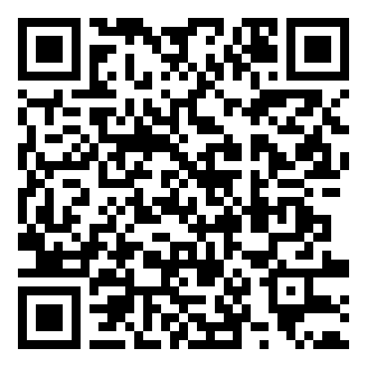

# מדריך מהיר - עוזר קולי על ESP32

קבוצה A2, קורס IoT, קיץ 2026. דף אחד כדי להפעיל את המערכת לבד. כל הקוד והמסמכים נמצאים בריפו ב-GitHub (סורקים את ה-QR).

## להתחיל

1. הלוח מחובר ב-USB למחשב, וה-hotspot של הטלפון דלוק (2.4GHz, והלוח צריך להכיר אותו - ראו "חיבור ל-hotspot" למטה).
2. ב-Chrome פתוח מרכז הבקרה (`control_center/control_center.html`). לוחצים **Connect board** ובוחרים את ה-COM של הלוח.
3. מחכים שכל הנורות למעלה יהיו ירוקות. העוזר אומר משפט פתיחה. אפשר ללחוץ **Self-test** לבדיקה מהירה של כל החלקים.
4. לוחצים **Talk** (או רווח) ומדברים, עד 3 שניות. הכי טוב באנגלית; עברית עובדת, אבל פחות טוב. או מדליקים **Hands-free** ופשוט מדברים.

לא מכירים את המסך? כפתור **Tour** למעלה עושה סיור קצר.

## חיבור ל-hotspot

העוזר צריך Wi-Fi, ובהדגמה משתמשים ב-hotspot של טלפון, לא ברשת של הטכניון (הלוח לא עבד איתה. הסיבה לא נבדקה, וההערכה היא התחברות ארגונית WPA2-Enterprise או דף כניסה). עושים את זה פעם אחת, לפני ההדגמה.

1. בטלפון מדליקים hotspot ב-**2.4GHz**. הלוח לא מתחבר ל-5GHz. באייפון: Personal Hotspot ← **Maximize Compatibility**. באנדרואיד: Hotspot ← Band ← 2.4 GHz.
2. שם הרשת עד 32 תווים, עדיף באנגלית ובלי אימוג'י ובלי גרש. הסיסמה 8 עד 64 תווים.
3. הלוח מכיר את הרשת באחד משני האופנים:
   - **בלי לקמפל:** במרכז הבקרה, בכרטיס **Wi-Fi network** (תחת Device controls), מזינים שם וסיסמה ולוחצים **Save & connect**. הכרטיס כותב Sent ואז Saved רק אחרי שהלוח אישר, והרשת נשמרת בלוח גם אחרי Reset.
   - **בקוד:** שם וסיסמה ב-`ESP32/SECRETS.h` (ברירת המחדל, כמו שמסביר ה-README). **Back to default** בכרטיס מחזיר אליה. אם רשת שנשמרה בכרטיס נכשלת פעמיים ברצף (למשל סיסמה שגויה), הלוח עובר לבד לרשת מ-`SECRETS.h`.
4. בודקים: Reset ללוח, ומחכים שנורית ה-Wi-Fi נהיית ירוקה. עושים את זה יום לפני, ועוד פעם בהגעה, ולא ברגע האחרון.
5. להחלפת רשת (למשל להדגמת "הרשת השתנתה"): hotspot של טלפון שני, גם הוא ב-2.4GHz, בכרטיס Wi-Fi network.

## מה לנסות

| נושא | מה להגיד | מה יקרה |
|---|---|---|
| מה הוא יודע | `What can you do?` | הוא מפרט במשפט אחד |
| שאלה כללית | `What is the capital of France?` | עונה בקול תוך כשנייה |
| אור | `Turn on the light` ואז `Dim the light to 30 percent` | ה-LED נדלק ומתעמעם, והנורה במסך זוהרת בהתאם |
| עוצמה | `Set the volume to 30 percent` ואז `A bit louder` | הסליידר זז והוא מאשר |
| תזכורת | `Remind me in 30 seconds to check the oven` | ספירה לאחור, ובסוף צפצופים, LED מהבהב ו-`Time's up - check the oven` |
| שעה | `What time is it?` | השעה והתאריך מהשעון של הלוח |
| חלק היום | `Is it day or night?` | לפי סליידר האור (מדמה חיישן), או לפי **Auto day-cycle**: יום מדומה שלם בכ-2 דקות |
| זיכרון | `My name is Dana` ואז `What is my name?` | זוכר את השם |

## מה רואים במסך

- **העיגול הגדול:** מה העוזר עושה עכשיו. ירוק מוכן, אדום מקשיב, כתום חושב, כחול מדבר.
- **Conversation:** מה הוא שמע ומה ענה, תוך כמה זמן, ומה הוא הפעיל בלוח.
- **Device controls:** עוצמה, השתקה, LED וחיישן האור. ההגדרות נשמרות בלוח גם אחרי Reset.
- **Statistics:** כמה פקודות, זמני תגובה וגרף. **Summary** מציג הכל במסך מלא.
- **Stage view** (מקש F): העוזר בגדול, למי שעומד רחוק.
- **On the board itself:** כפתור BOOT ככפתור Talk, וצלילי מצב, כדי להשתמש בלוח בלי המחשב. לפני הקלטה ידנית נשמע צליל התחלה גבוה וקצר, ולחיצה שנדחתה (למשל במצב Offline) נשמעת כצליל נמוך. החזקת BOOT 2 שניות היא בדיקת טכנאי: 4 צפצופים לפי הסדר Wi-Fi, OpenAI, SD card, מיקרופון (גבוה = תקין, נמוך = נכשל).

מה כל צבע והודעה אומרים: [מצבי המערכת והודעות שגיאה](system-states-and-errors.md).

## אם משהו לא עובד

| מה רואים | מה עושים |
|---|---|
| Talk כתוב Busy | העוזר עדיין מדבר (גם בברכה, בהודעת טיימר או בתשובה לשאלה בכתב), ו-Talk נדחה עד שהוא מסיים. מחכים לסוף התשובה, או לוחצים **Cancel** |
| נורית אדומה ב-Wi-Fi או ב-OpenAI, העיגול Offline | לבדוק את ה-hotspot (ושיש לו אינטרנט). הלוח מתחבר מחדש לבד, בלי Reset, ותוך שניות מרגע שהרשת חזרה. רשת אחרת: Device controls ← Wi-Fi network |
| נורית SD אדומה | אין כרטיס, או שהוצא בזמן שהלוח רץ: העוזר עובד רגיל, רק בלי הקלטות. מכניסים כרטיס FAT32 ולוחצים Reset (EN). החזרת הכרטיס בלי Reset משאירה את הנורית אדומה |
| באנר אדום על ה-USB | לחבר את הכבל שוב. מרכז הבקרה מתחבר לבד |
| הוא לא הבין | לדבר קרוב יותר, ועדיף באנגלית, ולבדוק בבועה מה הוא שמע. בחדר רועש אפשר לכתוב את השאלה בשדה שמתחת ל-Talk |
| Hands-free נדלק מרעש | להוריד את Sensitivity, או להשתמש ב-Talk |

