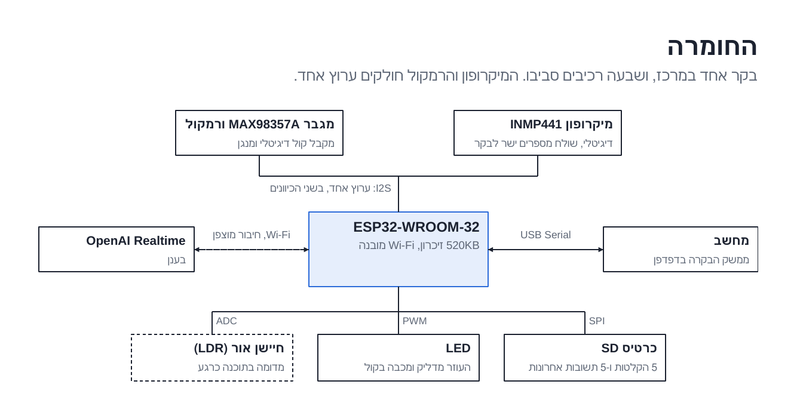
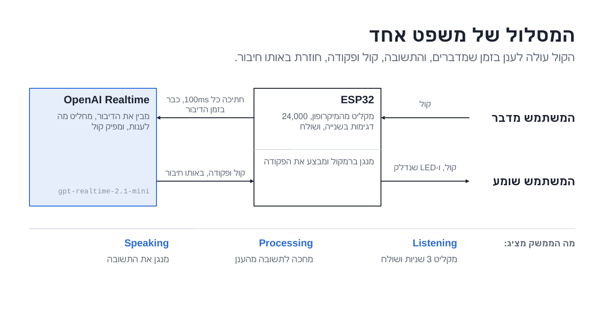
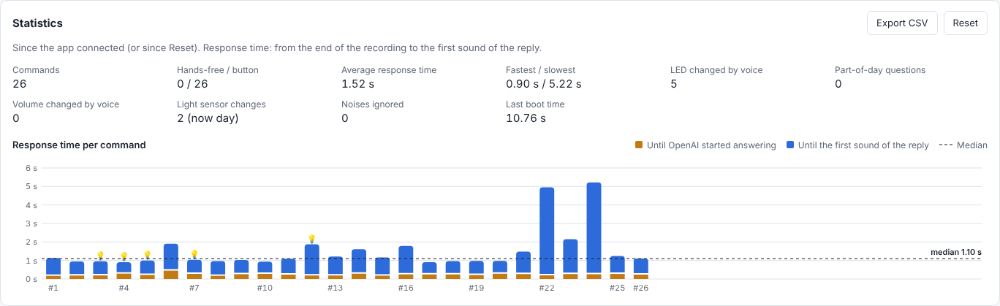
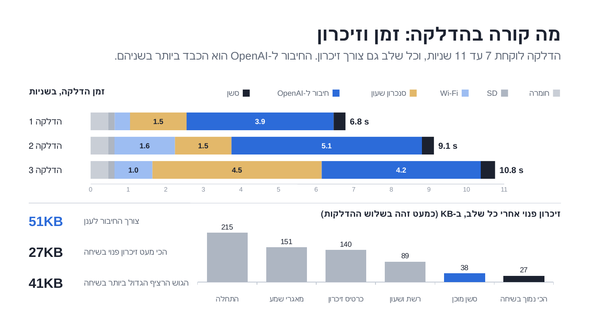

<div dir="rtl">

# עוזר קולי על ESP32

פרויקט בקורס IoT, טכניון, סמסטר קיץ 2026 (קבוצה A2).

בנינו עוזר קולי קטן על ESP32. מדברים איתו, הוא עונה בקול, והוא שולט בלוח: מדליק ומכבה את ה-LED, משנה את עוצמת הרמקול, מפעיל טיימר, אומר מה השעה, ואומר איזה חלק של היום עכשיו לפי חיישן אור. הבנת הדיבור קורית בענן (OpenAI Realtime API). ה-ESP32 מקליט מהמיקרופון, מזרים את הקול ב-Wi-Fi, מנגן את התשובה ומבצע את הפקודות. מרכז בקרה בדפדפן (דרך כבל USB) מראה מה הלוח עושה ומאפשר לשנות הגדרות.


<sub>מרכז הבקרה. הצילום נוצר משורות סטטוס של הלוח שהזנו לדף, עם משפטים מהלוגים שלנו.</sub>

## מה המערכת יודעת לעשות

- **שיחה בלחיצה:** לוחצים Talk (או רווח) ומדברים 3 שניות.
- **Hands-free:** בלי כפתור. גלאי קול (VAD) על ה-ESP32 מתחיל להקליט כשמתחילים לדבר ועוצר כשמפסיקים.
- **שליטה בלוח בקול:** `Turn on the light`, `Set the volume to 30 percent`, `A bit louder`.
- **טיימר ושעון:** `Set a timer for 20 seconds` (בסוף הלוח מצפצף וה-LED מהבהב), `What time is it?`.
- **חלק היום:** השאלה `Is it day or night?` נענית לפי חיישן האור (יום, ערב או לילה).
- **זיכרון שיחה:** זוכר מה אמרת קודם, למשל את השם שלך.
- **מרכז בקרה בדפדפן:**
  - נורות תקינות לכל רכיב, והמצב הנוכחי (מחכה, מקשיב, חושב, מדבר).
  - השיחה כבועות, עם שעה, זמן תגובה, ותגית כשהעוזר הפעיל משהו בלוח.
  - נורה שזוהרת כשה-LED דולק, אייקון של יום, ערב או לילה, וספירה לאחור של הטיימר.
  - הגדרות: עוצמה, השתקה, בהירות LED, ספי חיישן האור, רגישות ה-Hands-free. הכל נשמר ב-flash ונשאר אחרי Reset.
  - סטטיסטיקה: מספר הפקודות, זמני תגובה עם גרף לכל פקודה, וייצוא ל-CSV.
  - כרטיס "Try saying" עם דוגמאות. לחיצה על דוגמה מתחילה הקלטה.
  - צ'ק-ליסט להדגמה (כפתור Demo checklist) לפי סיפורי המשתמש.
  - **Stage view** (כפתור או מקש F): מסך מלא עם העיגול, המצב והשאלה והתשובה האחרונות באותיות גדולות, כדי שגם מי שעומד רחוק יראה.
  - **Replay a log:** מנגן לוג שמור כאילו הלוח שולח אותו עכשיו, במהירות רגילה או מהירה. טוב כגיבוי להדגמה ולניתוח ריצה ישנה (הסטטיסטיקה והגרף מתמלאים ממנו).
- **הקלטות ב-SD:** 5 הפקודות ו-5 התשובות האחרונות נשמרות. אפשר לנגן אותן במרכז הבקרה, לראות waveform ולמחוק.

## מסמכי ההדגמה

- [סיפורי משתמש (User Stories)](docs/user-stories.md), לפי סדר ההדגמה.
- [מקרי קצה](docs/edge-cases.md) שהמערכת יודעת לטפל בהם.
- גרסאות להדפסה: `docs/user-stories.pdf`, `docs/edge-cases.pdf`.
- [איך הקוד בנוי](docs/architecture.md): המודולים, המצבים של העוזר, ושורות ה-`@@` בין הלוח למרכז הבקרה.

## חומרה



| רכיב | הערות |
|---|---|
| ESP32-WROOM-32 | 520KB SRAM, בלי PSRAM |
| מיקרופון INMP441 (I2S) | |
| מגבר MAX98357A (I2S) ורמקול 4Ω 3W | |
| מודול כרטיס MicroSD (SPI) | שומר את ההקלטות |
| LED על הלוח (GPIO 2) | "האור" שהעוזר שולט בו |
| חיישן אור LDR | עוד לא מחובר. את הערך קובעים ממרכז הבקרה (`LIGHT <value>`) |

### דיאגרמת חיבורים

המיקרופון והמגבר חולקים את אותם קווי שעון של I2S (full duplex על פורט I2S אחד).

<div dir="ltr">

```
                 ESP32-WROOM-32
              +------------------+
 INMP441 SCK -| GPIO 26 (BCLK)   |- BCLK    MAX98357A
 INMP441 WS  -| GPIO 25 (LRC)    |- LRC     MAX98357A
 INMP441 SD  -| GPIO 21 (DIN)    |
              | GPIO 22 (DOUT)   |- DIN     MAX98357A --> speaker
              |                  |
   SD CS     -| GPIO 5           |
   SD SCK    -| GPIO 18          |
   SD MISO   -| GPIO 19          |
   SD MOSI   -| GPIO 23          |
              |                  |
              | GPIO 2           |- onboard LED
              +------------------+
 INMP441 L/R -> GND (left channel)
 VCC -> 3.3V (MAX98357A -> 5V), GND -> GND
```

</div>

| אות | פין ב-ESP32 |
|---|---|
| שעון ביטים של I2S (SCK של המיקרופון + BCLK של המגבר) | 26 |
| בחירת ערוץ של I2S (WS של המיקרופון + LRC של המגבר) | 25 |
| נתונים מהמיקרופון | 21 |
| נתונים למגבר | 22 |
| SD: CS / SCK / MISO / MOSI | 5 / 18 / 19 / 23 |
| LED | 2 |

הפינים מוגדרים בקובץ `test/config.h`.

## איך זה עובד



1. ה-ESP32 קורא את המיקרופון ב-24kHz, ‏16 ביט, בחתיכות של 100ms.
2. כל חתיכה נשלחת מיד בחיבור TLS WebSocket אחד ל-OpenAI. לא מחכים לסוף ההקלטה, כי 3 שניות של אודיו גולמי בכלל לא נכנסות בזיכרון הפנוי.
3. המודל עונה באודיו. ביקשנו mu-law ב-8kHz, שקטן פי 6 מ-PCM ב-24kHz, וכך זה נכנס בזיכרון. ה-ESP32 מפענח ומנגן.
4. כשהמודל רוצה לעשות משהו בלוח הוא קורא ל"כלי" עם סכמת JSON. ה-ESP32 מבצע, מחזיר תשובה, והמודל אומר מה הוא עשה.
5. הלוח מדפיס כל הזמן שורות `@@...` ל-Serial, ומרכז הבקרה קורא אותן.

### הכלים שהמודל יכול להפעיל

| כלי | מה הוא עושה | דוגמה |
|---|---|---|
| `set_board_state` | מדליק או מכבה את ה-LED | `Turn on the light` |
| `get_time_of_day` | קורא את חיישן האור ומחזיר יום, ערב או לילה | `Is it day or night?` |
| `set_volume` | קובע עוצמה באחוזים, או מגביר / מנמיך ב-20% | `Set the volume to 30 percent`, `Louder` |
| `get_current_time` | מחזיר את התאריך והשעה מהשעון של הלוח (מסונכרן מהאינטרנט) | `What time is it?` |
| `set_timer` | מפעיל טיימר של 1 עד 3600 שניות, או מבטל אותו | `Set a timer for 20 seconds` |


## תוכנה וגרסאות

| מה | גרסה |
|---|---|
| Arduino IDE | 2.3.10 |
| ESP32 Arduino core (Espressif) | 2.0.17 |
| WebSockets של Markus Sattler (Links2004) | 2.7.2 |
| ArduinoJson של Benoit Blanchon | 7.4.3 |
| מודל OpenAI | `gpt-realtime-2.1-mini` (קול לקול), ו-`gpt-4o-mini-transcribe` רק לטקסט שמוצג במרכז הבקרה |
| מרכז הבקרה | `tools/reply_audio_app.html`, רץ ב-Chrome או Edge (צריך Web Serial) |

כל השאר (`WiFi.h`, `SD.h`, `driver/i2s.h`, `Preferences`) מגיע עם ה-ESP32 core.

## איך מריצים

1. להתקין את הספריות מה-Library Manager של Arduino.
2. ליצור את `test/config.h` עם שם ה-Wi-Fi, הסיסמה ומפתח ה-API של OpenAI. הקובץ ב-`.gitignore`, לא מעלים אותו לגיט.
3. לפתוח את `test/test.ino` ב-Arduino IDE, לבחור ESP32 Dev Module ולצרוב. להשתמש ב-hotspot מהטלפון ולא ב-Wi-Fi של הטכניון.
4. לפתוח את `tools/reply_audio_app.html` ב-Chrome, ללחוץ **Connect board** ולבחור את ה-COM של הלוח (115200 baud).
5. לחכות לנורות הירוקות ולברכת הפתיחה, ואז ללחוץ **Talk** או להדליק **Hands-free**.

## מבנה הריפו

- הקושחה הנוכחית (הלולאה הראשית והלוגיקה של השיחה): `test/test.ino`
- מודולים (Wi-Fi, החיבור ל-OpenAI, אודיו I2S, גלאי הקול, משימת המיקרופון, Hands-free, הקלטות ב-SD, העברת קבצים, הגדרות, מדידות, שורות הסטטוס ל-GUI): `test/*_utils.cpp/.h`
- השלבים הקודמים. בנינו את הפרויקט בצעדים קטנים ובדקנו כל צעד לבד: `test/NN_*.ino.inactive`
- מרכז הבקרה: `tools/reply_audio_app.html`
- סקריפט שהופך לוג שמור לטבלאות המדידה שלמטה: `tools/measurements_report.py`
- כלי שמריץ את גלאי הקול על קבצי WAV במחשב, כדי לבדוק אותו בלי הלוח: `tools/vad_replay.cpp`
- מסמכי ההדגמה, לוג המדידות והתמונות של ה-README: `docs/`

## מדידות ביצועים

### איך מדדנו

הוספנו לקושחה נקודות מדידה (שלב 29, `measurement_utils`). כל שאלה מדפיסה שורת `@@TIMING` וכל הדלקה מדפיסה שורת `@@BOOT_TIMING`, עם זמנים מ-`millis()`, גדלים, רמות מיקרופון וזיכרון פנוי. שמרנו את הלוג ממרכז הבקרה והרצנו עליו את `tools/measurements_report.py`.

תנאי הבדיקה (15.10.2026): hotspot מטלפון, RSSI בין ‎-40 ל-‎-45 dBm, חדר שקט, 26 שאלות ו-3 הדלקות. שאלות 1-19 דיבור רגיל מכחצי מטר, 20-22 שקט, 23-24 מרחוק (כ-2 מטר), 25 קרוב, 26 לחישה. מצב לחיצה (הקלטה של 3 שניות). כל הזמנים בשאלה נמדדים מסוף ההקלטה.

הלוג המלא: `docs/measurements/esp32_log_2026-10-15.txt`.

### תוצאות


| מה | תוצאה |
|---|---|
| שאלות שהסתיימו בהצלחה | 26 מתוך 26 |
| מסוף ההקלטה עד ההודעה הראשונה מהשרת (חציון) | כ-0.3 שניות |
| מסוף ההקלטה עד הצליל הראשון של התשובה (חציון) | כ-1.1 שניות |
| שאלות שבהן התשובה התחילה תוך פחות מ-2 שניות | 23 מתוך 26 (האיטיות, כ-5 שניות, היו בשקט ובדיבור מרחוק) |
| מהבקשה `Turn on the light` עד שה-LED נדלק | 0.97 שניות (האישור הקולי התחיל אחרי 1.9 שניות) |
| הדלקה מלאה (עד שמוכן לשיחה) | 6.8 / 9.1 / 10.8 שניות |
| השלב הארוך בהדלקה | החיבור המוצפן ל-OpenAI, ‏3.9 עד 5.1 שניות |

אותו לוג, כפי שמרכז הבקרה מציג אותו בחלונית הסטטיסטיקה:





| זיכרון (heap) | |
|---|---|
| פנוי בהדלקה | 215KB |
| פנוי כשהסשן מוכן | 38KB |
| פנוי בזמן שיחה | כ-45KB, יציב לאורך 26 שאלות (אין דליפה) |
| הכי מעט פנוי בזמן שיחה | 27KB |
| הצרכן הגדול ביותר | החיבור המוצפן וה-WebSocket, כ-51KB |

| שמע | |
|---|---|
| רמת מיקרופון, דיבור רגיל (חציון) | ‎-19 dBFS |
| קרוב / רחוק / לחישה | ‎-17 / ‎-30 / ‎-32 dBFS |
| קיטום | בשאלה אחת מתוך 26 |
| נשלח לענן בכל שאלה | כ-193KB (PCM ב-24kHz, ‏384 kbps) |
| אודיו התשובה | mu-law ב-8kHz, ‏64 kbps |

### בעיה שמצאנו במדידות ותיקנו

ב-21 מתוך 26 השאלות הקושחה התריעה שדגימות מהמיקרופון אבדו. הסיבה: מאגר ה-DMA של המיקרופון מחזיק רק 150ms, ולפעמים שליחה אחת ב-Wi-Fi נתקעה עד 465ms, וקול ישן נדרס. בממוצע אבדו 0.14 שניות מתוך 3 (במקרה הגרוע 0.54). כמות הקול שאבדה התאימה לשליחה האיטית ביותר באותה שאלה (מקדם מתאם 0.93).

התיקון (שלב 30): עכשיו משימת FreeRTOS נפרדת קוראת את המיקרופון כל 20ms, והאודיו מחכה בתור (בתוך מאגר הניגון, שפנוי בזמן הקלטה) עד שהוא נשלח. שליחה איטית רק מעכבת את האודיו ולא מאבדת אותו. התור מחזיק כ-1.36 שניות.

### גלאי הקול של מצב Hands-free

גלאי הקול (`vad_utils`) בודק את העוצמה בתחום התדרים של דיבור לעומת רעש החדר, וגם אם הקול "קולי" ואם יש בו קצב של הברות. בדקנו אותו במחשב עם `tools/vad_replay.cpp` על הקלטות ציבוריות: 112 קטעי רעש ו-100 קטעי דיבור עם רעשי בית ברקע.

| בדיקה | תוצאה |
|---|---|
| דיבור רגיל: ההקלטה התחילה | בכל הקטעים, והמילה הראשונה לא נחתכה |
| דיבור שקט מאוד מול רעש רקע | 20 עד 200ms מההתחלה נחתכו ב-7 מתוך 27 קטעים |
| קטעי רעש שנשלחו ל-OpenAI | 20 מתוך 112 (שיעול, צחוק, דלת חורקת, פעמונים, מים זורמים) |
| דפיקות, מחיאות כפיים, צעדים, גשם, שואב אבק | אף פעם לא התחילו הקלטה |

המספרים האלה מהקלטות, לא מהמיקרופון שלנו בחדר.

## מגבלות ידועות

- ה-LDR עוד לא מחובר. את ערך האור קובעים ממרכז הבקרה.
- השיחה עובדת באנגלית. בעברית התשובות חזרו באנגלית והתמלול השתבש.
- במצב Hands-free, טלוויזיה או אנשים אחרים שמדברים נחשבים לדיבור.
- מי שמתחיל לדבר בכ-0.9 השניות הראשונות אחרי סוף תשובה עלול לאבד את תחילת המשפט (המיקרופון סגור 0.6 שניות כדי שהלוח לא ישמע את עצמו).
- צריך אינטרנט. בלי OpenAI העוזר לא עונה.

## הצוות

להשלים

</div>
