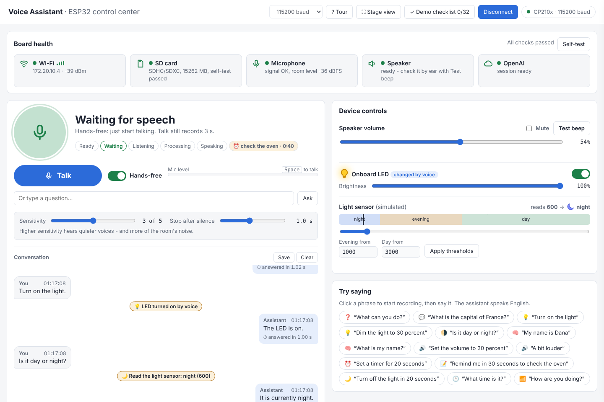
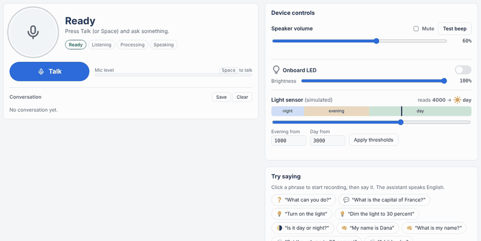
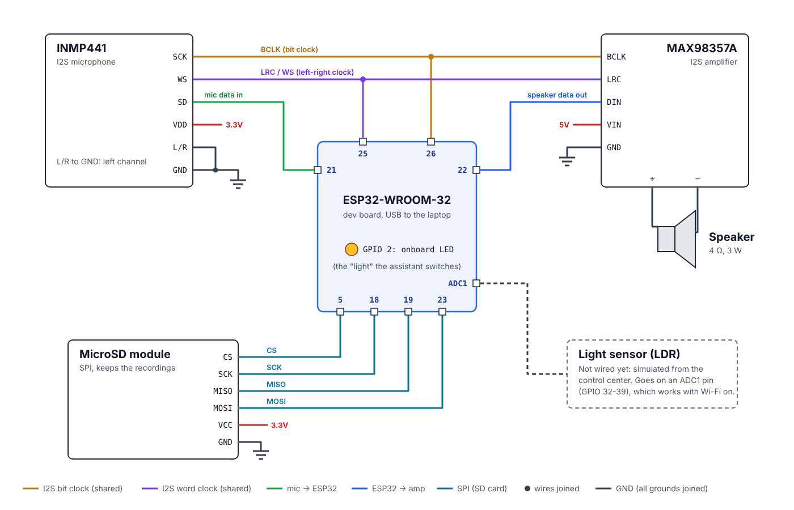
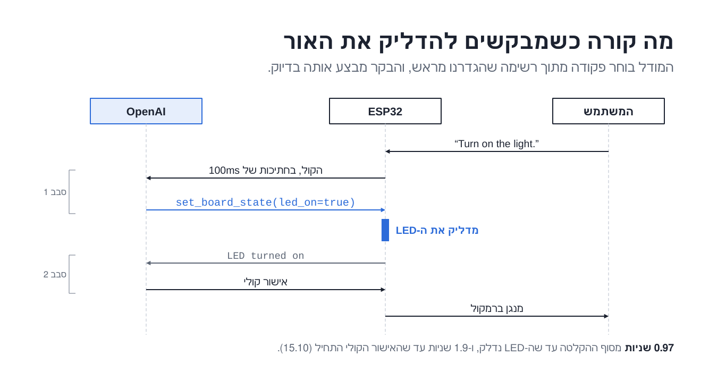
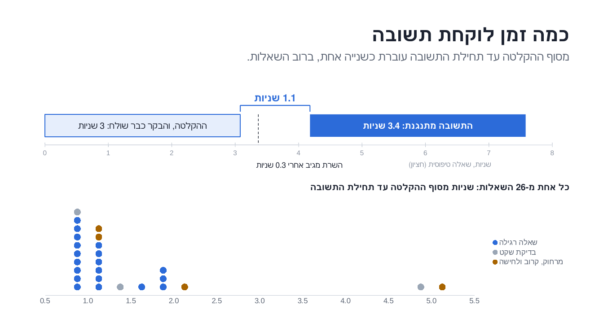

<div dir="rtl">

# Voice Assistant on ESP32
**Project by:** Solomon Mekhiln, Tomer Gilan, Itamar Cohen

פרויקט בקורס IoT ‏(236333), טכניון, סמסטר קיץ 2026, קבוצה A2.

## על הפרויקט

בנינו עוזר קולי קטן על ESP32. מדברים איתו, הוא עונה בקול, והוא שולט בלוח: מדליק, מכבה ומעמעם את ה-LED, משנה את עוצמת הרמקול, מפעיל טיימר ותזכורת, אומר מה השעה, ואומר איזה חלק של היום עכשיו לפי חיישן אור (הערך מדומה ממרכז הבקרה).

הבנת הדיבור קורית בענן (OpenAI Realtime API). ה-ESP32 מקליט מהמיקרופון, מזרים את הקול ב-Wi-Fi, מנגן את התשובה, ומבצע את הפקודות. גלאי הקול (Hands-free), הטיימר, השעון, ההקלטות וההגדרות רצים על הבקר עצמו. מרכז בקרה בדפדפן (דרך כבל USB) מראה מה הלוח עושה ומאפשר לשנות כל הגדרה בלי לקמפל.



<sub>מרכז הבקרה. הצילום נוצר משורות סטטוס של הלוח שהזנו לדף, עם משפטים מהלוגים שלנו.</sub>

## מה המערכת יודעת לעשות

- **שיחה בלחיצה:** Talk במרכז הבקרה, רווח, או **כפתור BOOT על הלוח** (אופציה). מדברים 3 שניות.
- **Hands-free:** בלי כפתור. גלאי קול (VAD) על ה-ESP32 מתחיל להקליט כשמתחילים לדבר ועוצר כשמפסיקים, ולא נדלק מדפיקות, מחיאות כפיים וצעדים.
- **שליטה בלוח בקול:** `Turn on the light`, `Dim the light to 30 percent`, `Set the volume to 30 percent`, `A bit louder`.
- **טיימר, תזכורת ושעון:** `Set a timer for 30 seconds`, `Remind me in 30 seconds to check the oven`, `Turn off the light in 20 seconds`, `What time is it?`.
- **חלק היום:** `Is it day or night?` נענית לפי חיישן האור (ערך מדומה ממרכז הבקרה).
- **מצב הלוח:** `How are you doing?`: עוצמת ה-Wi-Fi, כמה זמן הוא דלוק וכמה זיכרון פנוי.
- **זיכרון שיחה:** זוכר מה נאמר קודם, למשל את השם שלך.
- **אנגלית ועברית:** הכי טוב באנגלית. בעברית הוא מבין ועונה, אבל באיכות נמוכה יותר, והתמלול במסך משתבש לעתים.
- **עובד גם בלי המחשב:** Hands-free, כפתור BOOT וצלילי מצב נשמרים בלוח, ו-power bank מספיק (מחברים אותו רק אחרי שמנתקים את ה-USB מהמחשב).
- **רובסטיות:** בלי Wi-Fi או בלי OpenAI (גם כש-Wi-Fi דלוק בלי אינטרנט) הלוח עובר למצב **Offline**, נורית OpenAI אדומה, וממשיך לנסות כל 30 שניות (הטיימר והפקדים עובדים). כש-Wi-Fi או ה-hotspot חוזרים, או שעוברים רשת, החיבור ל-OpenAI נפתח מחדש תוך שניות, ואם הוא עדיין לא עונה אחרי 10 שניות הלוח חוזר לנסות כל 30 שניות. חיבור "תקוע" מתגלה לבד: פעימת לב (ping כל 15 שניות), ושרת ששותק 15 שניות בזמן שאלה נסגר ונפתח מחדש (השיחה מתחילה מחדש). רשת שנשמרה ממרכז הבקרה ונכשלת פעמיים ברצף (למשל סיסמה שגויה) מוחלפת זמנית ברשת מ-`SECRETS.h`. בלי כרטיס SD הוא עובד בלי הקלטות. את רשת ה-Wi-Fi מחליפים ממרכז הבקרה, בלי קימפול. הפירוט ב-[מקרי הקצה](Documentation/edge-cases.md) וב[רשימה המורחבת](Documentation/edge-cases-extended.md).
- **מרכז בקרה בדפדפן:** נורות תקינות לכל רכיב ו-Self-test, השיחה כבועות עם זמן תגובה, כל ההגדרות (נשמרות ב-flash), סטטיסטיקה וגרף זמני תגובה עם ייצוא CSV (עם תאריך ומספר הפעלה של הלוח), ההקלטות מה-SD עם נגן ו-waveform, שאלה בכתב לחדר רועש, ו-Replay של לוג שמור (עובד בלי לוח, גם על לוגים של `tools/serial_logger.ps1`, ולא מתערבב בסטטיסטיקה החיה ובלוג השמור).



## תיקיות הריפו

| תיקייה | מה יש בה |
|---|---|
| `ESP32/` | הקושחה: `ESP32.ino` (השיחה ומכונת המצבים), המודולים `*_utils.cpp/.h`, `parameters.h` (כל הפרמטרים הקבועים), ו-`SECRETS.example.h` (תבנית לסודות) |
| `control_center/` | מרכז הבקרה: `control_center.html` ו-`control_center.js` (שני הקבצים חייבים להישאר באותה תיקייה), שרץ ב-Chrome או Edge |
| `Unit Tests/` | בדיקות יחידה לכל רכיב חומרה (רמקול, מיקרופון, Wi-Fi, SD, LED, כפתור, ו-LDR לכשיחובר) ו[הדוח שלהן](Unit%20Tests/README.md) |
| `Parameters/` | [רשימת כל הפרמטרים](Parameters/parameters.md): מה משנים ממרכז הבקרה, מה ב-`parameters.h`, ומה ב-`SECRETS.h` |
| `Documentation/` | כל התיעוד (רשימה למטה), תמונות, הלוג של המדידות, ו-`development_steps/` עם כל השלבים שבנינו בדרך |
| `tools/` | כלים במחשב: סיכום מדידות מלוג, בדיקת גלאי הקול על קבצי WAV, לוגר ל-Serial, ואבחון של ה-API |

### התיעוד

| מסמך | מה בו |
|---|---|
| [מדריך מהיר](Documentation/quick-start.md) | דף אחד: איך מפעילים ומה לנסות |
| [מצבי המערכת והודעות שגיאה](Documentation/system-states-and-errors.md) | מה כל מצב וכל נורית אומרים, ומה עושים |
| [הוראות כיול](Documentation/calibration.md) | חיישן האור, הרגישות של Hands-free, עוצמת המיקרופון |
| [איך הקוד בנוי](Documentation/architecture.md) | המודולים, מכונת המצבים, זרימת השימוש, והפרוטוקול בין הלוח למרכז הבקרה |
| [החלטות משמעותיות](Documentation/decisions.md) | מה החלטנו, למה, ועל מה זה נשען (מדידה, ניסוי או תיעוד) |
| [סיפורי משתמש](Documentation/user-stories.md) ([PDF](Documentation/user-stories.pdf)) | לפי סדר ההדגמה |
| [מקרי קצה](Documentation/edge-cases.md) ([PDF](Documentation/edge-cases.pdf)) | הרשימה המקורית של מקרי הקצה שבדקנו |
| [מקרי קצה - מורחב](Documentation/edge-cases-extended.md) ([PDF](Documentation/edge-cases-extended.pdf)) | בפורמט של הקורס (חיווי והתאוששות), עם המקרים של גרסת ההגשה. **להדפסה: `edge-cases-extended.pdf` (2 עותקים)** |
| [תוכנית ההדגמה](Documentation/demo-plan.md) ו[שאלות צפויות](Documentation/questions.md) | הכנה להגשה |
| [דוח בדיקות על הלוח](Documentation/board-tests-toSubmit.md) | הבדיקות של גרסת ההגשה על הלוח (רובסטיות, Wi-Fi, BOOT, צלילי מצב), כולן עברו |
| [גרסאות הפרויקט](Documentation/versions.md) | כל השלבים, מהצליל הראשון ועד הגרסה הנוכחית |

## חומרה


| רכיב | כמות | הערות |
|---|---|---|
| ESP32-WROOM-32 DevKit | 1 | 520KB SRAM, בלי PSRAM. ה-LED (‏GPIO 2) וכפתור BOOT (‏GPIO 0) שעל הלוח |
| מיקרופון INMP441 (I2S) | 1 | |
| מגבר MAX98357A (I2S) | 1 | |
| רמקול 4Ω 3W | 1 | |
| מודול MicroSD (SPI) וכרטיס MicroSD (FAT32) | 1 + 1 | ההקלטות. לא חובה: בלעדיו הלוח עובד בלי הקלטות |
| LDR (נגד תלוי אור) ונגד 10kΩ | 1 + 1 | חיישן האור. **לא מחובר:** הערך מדומה ממרכז הבקרה, לפי הנחיית מדריך הקורס. נשאר ברשימה כי הקוד והכיול ל-LDR אמיתי מוכנים ([כיול](Documentation/calibration.md)) |
| מטריצה (breadboard) | 1 | |
| חוטי חיבור (jumper) | סט, כ-20 חוטים | המיקרופון 6 (כולל L/R ל-GND), המגבר 5, הרמקול 2, מודול ה-SD 6 |
| כבל USB | 1 | הזנה וחיבור למחשב (מרכז הבקרה, צריבה) |
| power bank | 1 | לא חובה: הלוח עובד גם על power bank בלי מחשב. לא מחברים אותו יחד עם USB למחשב (בטיחות, הנחיית הקורס) |

### דיאגרמת חיבורים

המיקרופון והמגבר חולקים את אותם קווי שעון של I2S (פורט אחד, full duplex). הפינים מוגדרים ב-`ESP32/parameters.h`.



| אות | פין ב-ESP32 |
|---|---|
| שעון ביטים של I2S (SCK של המיקרופון + BCLK של המגבר) | 26 |
| בחירת ערוץ של I2S (WS של המיקרופון + LRC של המגבר) | 25 |
| נתונים מהמיקרופון (SD) | 21 |
| נתונים למגבר (DIN) | 22 |
| SD: CS / SCK / MISO / MOSI | 5 / 18 / 19 / 23 |
| בחירת ערוץ של המיקרופון (L/R) | ל-GND (ערוץ שמאל), בלי פין ב-ESP32 |
| המגבר: הכניסות SD ו-GAIN | לא מחוברות (כמו בדיאגרמה) |
| הרמקול | ‏+ ו-‏- למוצא של המגבר |
| LED | 2 (על הלוח) |
| כפתור Talk | 0 (BOOT, על הלוח) |
| LDR (לא מחובר, מדומה ממרכז הבקרה) | 34 (ADC1), לכשיחובר |
| הזנה | המיקרופון וה-SD ל-3.3V, המגבר ל-5V, הכל ל-GND משותף |

<details>
<summary>אותו דבר בטקסט</summary>

<div dir="ltr">

```
                 ESP32-WROOM-32
              +------------------+
 INMP441 SCK -| GPIO 26 (BCLK)   |- BCLK    MAX98357A
 INMP441 WS  -| GPIO 25 (LRC)    |- LRC     MAX98357A
 INMP441 SD  -| GPIO 21 (DIN)    |
              | GPIO 22 (DOUT)   |- DIN     MAX98357A --> speaker
              |                  |
   SD CS     -| GPIO 5           |
   SD SCK    -| GPIO 18          |
   SD MISO   -| GPIO 19          |
   SD MOSI   -| GPIO 23          |
              |                  |
              | GPIO 2           |- onboard LED
              | GPIO 0           |- onboard BOOT button
  LDR divider-| GPIO 34 (ADC1)   |  (not wired: simulated from the control center)
              +------------------+
 VCC -> 3.3V (MAX98357A -> 5V), GND -> GND
```

</div>

</details>

## תוכנה וגרסאות

| מה | גרסה |
|---|---|
| ESP32 SDK: ESP32 Arduino core (Espressif) | 2.0.17 (ESP-IDF 4.4) |
| Arduino IDE | 2.3.10 |
| WebSockets של Markus Sattler (Links2004) | 2.7.2 |
| ArduinoJson של Benoit Blanchon | 7.4.3 |
| מודל OpenAI | `gpt-realtime-2.1-mini` (קול לקול), ו-`gpt-4o-mini-transcribe` לטקסט שמוצג במרכז הבקרה |
| מרכז הבקרה | Chrome או Edge (צריך Web Serial) |
| Python, לכלים `tools/measurements_report.py` ו-`tools/realtime_audio_diagnostic.py` | 3.6 ומעלה (הכלים משתמשים ב-f-strings). נבדק עם 3.11.2. `measurements_report.py` משתמש בספרייה הסטנדרטית בלבד |
| `websocket-client` (רק ל-`realtime_audio_diagnostic.py`) | `pip install websocket-client`. נבדק עם 1.8.0 |
| מהדר C++11, לכלי `tools/vad_replay.cpp` | `g++` מכל גרסה שתומכת ב-C++11 (ב-Windows: MSYS2/MinGW) |
| PowerShell, ללוגר `tools/serial_logger.ps1` | Windows PowerShell 5.1 (נבדק) |

כל השאר מגיע עם ה-ESP32 core: `WiFi.h`, `SD.h`, `driver/i2s.h`, `Preferences` (NVS), mbedTLS ו-FreeRTOS. ישירות מ-ESP-IDF ו-FreeRTOS, ולא דרך wrapper של Arduino, השתמשנו ב: מנהל ה-I2S הישן `driver/i2s.h` במצב full duplex, `xTaskCreatePinnedToCore` (משימת המיקרופון, מוצמדת לליבה 1 בעדיפות 3), `esp_timer` (דגימת כפתור BOOT), `heap_caps_*` (אבחון זיכרון והקצאות שנכשלו), `esp_random`, ו-mbedTLS ל-base64. דרך ה-wrappers של Arduino: NVS (`Preferences`, לא ישירות), PWM (`ledc`), SNTP (`configTime`), SD ו-Wi-Fi.

## התקנה והרצה

1. ב-Arduino IDE, ב-**Boards Manager**, מתקינים **esp32 by Espressif Systems** גרסה **2.0.17**. אחר כך מתקינים את שתי הספריות מה-**Library Manager**, בגרסאות שבטבלה.
2. מעתיקים את `ESP32/SECRETS.example.h` ל-`ESP32/SECRETS.h` וממלאים שם ו-סיסמה של Wi-Fi (‏2.4GHz) ומפתח OpenAI. הקובץ ב-`.gitignore`. בלעדיו הקומפילציה נעצרת עם הסבר.
3. פותחים את `ESP32/ESP32.ino` ב-Arduino IDE, בוחרים **ESP32 Dev Module** וצורבים. אפשר גם משורת הפקודה: `arduino-cli compile --fqbn esp32:esp32:esp32 ESP32`.
4. פותחים את `control_center/control_center.html` ב-Chrome, לוחצים **Connect board** ובוחרים את ה-COM של הלוח (115200).
5. מחכים לנורות הירוקות ולברכת הפתיחה, ואז לוחצים **Talk** או מדליקים **Hands-free**.

**בטיחות:** לוח שמחובר ב-USB למחשב לא מחברים לאף מקור מתח נוסף (כולל power bank ופין 5V). לשימוש בלי מחשב מנתקים קודם את ה-USB, ורק אז מחברים power bank.

**רשת אחרת?** בכרטיס **Wi-Fi network** במרכז הבקרה, בלי לקמפל. הרשת של הטכניון לא עבדה עם הלוח. הסיבה לא נבדקה (ההערכה: התחברות ארגונית WPA2-Enterprise או דף כניסה), ולכן מדגימים על hotspot מהטלפון.

**אין לוח ביד?** פותחים את מרכז הבקרה, לוחצים **Replay a log** ובוחרים `Documentation/measurements/esp32_log_2026-10-15.txt`. הלוג של 26 השאלות מתנגן כאילו הלוח מחובר.

**קובץ מקומפל:** לא צירפנו `compiled_program.bin`, כי הסיסמה ומפתח ה-API מקומפלים לתוכו. כדי לייצא: ב-Arduino IDE, Sketch ← Export Compiled Binary.

## איך זה עובד


1. משימה נפרדת (FreeRTOS) קוראת את המיקרופון ב-24kHz כל 20ms, גם כשהלולאה הראשית עסוקה.
2. כל 100ms של אודיו נשלחים מיד בחיבור WebSocket מוצפן אחד ל-OpenAI. לא מחכים לסוף ההקלטה, כי 3 שניות של אודיו גולמי בכלל לא נכנסות בזיכרון הפנוי.
3. המודל עונה באודיו mu-law ב-8kHz (פי 6 קטן מ-PCM ב-24kHz). ה-ESP32 מפענח ומנגן.
4. כשהמודל רוצה לעשות משהו בלוח, הוא קורא ל"כלי" עם סכמת JSON. ה-ESP32 מבצע, מחזיר תשובה, והמודל אומר מה נעשה.
5. הלוח מדפיס כל הזמן שורות `@@...` ל-Serial, ומרכז הבקרה קורא אותן ([הפרוטוקול](Documentation/architecture.md)).

### הכלים שהמודל יכול להפעיל

| כלי | מה הוא עושה | דוגמה |
|---|---|---|
| `set_board_state` | מדליק או מכבה את ה-LED, ואפשר גם לקבוע בהירות | `Turn on the light`, `Dim the light to 30 percent` |
| `get_time_of_day` | קורא את חיישן האור (מדומה ממרכז הבקרה) ומחזיר יום, ערב או לילה | `Is it day or night?` |
| `set_volume` | קובע עוצמה באחוזים (‏10-100), או מגביר / מנמיך ב-20% | `Set the volume to 30 percent`, `Louder` |
| `get_current_time` | התאריך והשעה מהשעון של הלוח (מסונכרן מהאינטרנט, לפי שעון ישראל כולל שעון קיץ), וכמה נשאר לטיימר | `What time is it?` |
| `get_board_status` | עוצמת ה-Wi-Fi, כמה דקות הלוח דלוק וכמה זיכרון פנוי | `How are you doing?` |
| `set_timer` | טיימר של 1 עד 3600 שניות (בהדגמה 20 עד 60 שניות), או ביטול (0). מעל שעה נקבעת שעה והעוזר אומר זאת. ערך שלילי או קצר משנייה נדחה, והעוזר מבקש שוב בלי לגעת בטיימר שרץ. בסוף העוזר אומר את זה בקול (גם על מה התזכורת), ואפשר להדליק או לכבות את האור | `Remind me in 30 seconds to check the oven`, `Turn off the light in 20 seconds` |



## מדידות ביצועים

### איך מדדנו

הוספנו לקושחה נקודות מדידה (`measurement_utils`). כל שאלה מדפיסה שורת `@@TIMING`, וכל הדלקה שורת `@@BOOT_TIMING`, עם זמנים מ-`millis()`, גדלים, רמות מיקרופון וזיכרון פנוי. שמרנו את הלוג ממרכז הבקרה והרצנו עליו את `tools/measurements_report.py`.

תנאי הבדיקה (15.10.2026): hotspot מטלפון, RSSI בהדלקה בין ‎-37 ל-‎-45 dBm ובזמן השאלות חציון ‎-48 (טווח ‎-38 עד ‎-62), חדר שקט, 26 שאלות ו-3 הדלקות. שאלות 1-19 דיבור רגיל מכחצי מטר, 20-22 שקט, 23-24 מרחוק (כ-2 מטר), 25 קרוב, 26 לחישה. מצב לחיצה (3 שניות). כל הזמנים בשאלה נמדדים מסוף ההקלטה. **הקושחה במדידה הזאת היא של שלב 29, לפני משימת המיקרופון של שלב 30.** הלוג המלא: `Documentation/measurements/esp32_log_2026-10-15.txt`.

### תוצאות



| מה | תוצאה |
|---|---|
| שאלות שהסתיימו בהצלחה | 26 מתוך 26 |
| מסוף ההקלטה עד ההודעה הראשונה מהשרת (חציון) | כ-0.3 שניות |
| מסוף ההקלטה עד הצליל הראשון של התשובה (חציון) | כ-1.1 שניות |
| שאלות שבהן התשובה התחילה תוך פחות מ-2 שניות | 23 מתוך 26 (האיטיות, כ-5 שניות, היו בשקט ובדיבור מרחוק) |
| מהבקשה `Turn on the light` עד שה-LED נדלק | 0.97 שניות (האישור הקולי התחיל אחרי 1.9 שניות) |
| הדלקה מלאה (עד שמוכן לשיחה) | 6.8 / 9.1 / 10.8 שניות |
| השלב הארוך בהדלקה | החיבור המוצפן ל-OpenAI, ‏3.9 עד 5.1 שניות |


| זיכרון (heap) | |
|---|---|
| פנוי בהדלקה | 215KB |
| פנוי כשהסשן מוכן | 38KB |
| פנוי בזמן שיחה | כ-45KB, יציב לאורך 26 שאלות (אין דליפה) |
| הכי מעט פנוי בזמן שיחה | 27KB |
| הצרכן הגדול ביותר | החיבור המוצפן וה-WebSocket, כ-51KB |
| גודל הקושחה (הגרסה הנוכחית) | 1.08MB, ‏82% מה-flash |
| RAM קבוע (משתנים גלובליים) | 75KB מתוך 320KB |

| שמע | |
|---|---|
| רמת מיקרופון, דיבור רגיל (חציון) | ‎-19 dBFS |
| קרוב / רחוק / לחישה | ‎-17 / ‎-30 / ‎-32 dBFS |
| קיטום | בשאלה אחת מתוך 26 |
| נשלח לענן בכל שאלה | כ-193KB (PCM ב-24kHz, ‏384 kbps) |
| אודיו התשובה | mu-law ב-8kHz, ‏64 kbps |

### בעיה שמצאנו במדידות ותיקנו

ב-21 מתוך 26 השאלות הקושחה התריעה שדגימות מהמיקרופון אבדו. הסיבה: מאגר ה-DMA של המיקרופון מחזיק רק 150ms, ולפעמים שליחה אחת ב-Wi-Fi נתקעה עד 465ms, וקול ישן נדרס. בממוצע אבדו 0.14 שניות מתוך 3 (במקרה הגרוע 0.54). כמות הקול שאבדה התאימה לשליחה האיטית ביותר באותה שאלה (מקדם מתאם 0.93).

התיקון (שלב 30): משימת FreeRTOS נפרדת קוראת את המיקרופון כל 20ms, והאודיו מחכה בתור (בתוך מאגר הניגון, שפנוי בזמן הקלטה) עד שהוא נשלח. שליחה איטית רק מעכבת את האודיו ולא מאבדת אותו. התור מחזיק כ-1.36 שניות. הקושחה מדווחת בכל שאלה כמה אודיו אבד (`dropped_ms`), כך שמדידה חוזרת עם הקושחה הנוכחית תראה את התוצאה.

**המדידה אחרי התיקון עוד לא רצה**, ולכן הטבלאות למעלה הן של קושחת שלב 29 בלבד. היא תיווצר כך: מריצים כמה שאלות ברצף על הקושחה הנוכחית כש-`tools/serial_logger.ps1` שומר את הלוג, ואז `python tools/measurements_report.py <קובץ הלוג>` כותב `timing.csv` ו-`summary.md` (בתיקיית `measurements` ליד הלוג). השורה של `dropped_ms` (חציון ומקסימום) תתווסף לטבלת התוצאות למעלה, לצד מדידת שלב 29.

### גלאי הקול של מצב Hands-free

גלאי הקול (`vad_utils`) בודק את העוצמה בתחום התדרים של דיבור לעומת רעש החדר, וגם אם הקול "קולי" ואם יש בו קצב של הברות. בדקנו אותו במחשב עם `tools/vad_replay.cpp` על הקלטות ציבוריות: 112 קטעי רעש ו-100 קטעי דיבור עם רעשי בית ברקע.

| בדיקה | קטעים | תוצאה | שיעור |
|---|---|---|---|
| דיבור רגיל: ההקלטה התחילה, והמילה הראשונה לא נחתכה | 100 | בכולם | 100/100 = **100%** |
| דיבור שקט מאוד מול רעש רקע: 20 עד 200ms מההתחלה נחתכו | 27 | ב-7 | 7/27 = **26%** נחתכו (74% בלי חיתוך) |
| קטעי רעש שנשלחו ל-OpenAI (הפעלת שווא) | 112 | ב-20 | 20/112 = **17.9%** (82.1% נדחו) |
| דפיקות, מחיאות כפיים, צעדים, גשם, שואב אבק | מתוך 112 | אף פעם לא התחילו הקלטה | 0% |

ההפעלות השגויות היו בשיעול, צחוק, דלת חורקת, פעמונים ומים זורמים.

**איך בדקנו:**
- **הכלי:** `tools/vad_replay.cpp` מקמפל את אותו קובץ `ESP32/vad_utils.cpp` שרץ על הלוח, ומריץ אותו על קבצים במחשב. הוא מדמה את הלולאה של Hands-free: מחכה לדיבור, מקליט החל מ-500ms לפני שההתחלה אושרה, מסיים אחרי שקט, או זורק קטע שלא נשמע כמו דיבור, וחוזר לחכות. כך יודעים לכל קטע אם הוא היה נשלח ל-OpenAI, ואיפה ההקלטה הייתה מתחילה.
- **בנייה והרצה:** `g++ -std=c++11 -O2 -I ESP32 tools/vad_replay.cpp ESP32/vad_utils.cpp -o vad_replay`, ואז `vad_replay [--sensitivity 1-5] [--hangover <ms>] <קבצים>`. לדוגמה: `vad_replay --sensitivity 3 --hangover 1000 clips/*.wav`.
- **פרמטרים:** ברירות המחדל של הקושחה (`ESP32/parameters.h`: `kDefaultVadSensitivity`, `kDefaultVadHangoverMs`): רגישות 3 (מתוך 1 עד 5) ושקט של 1000ms שמסיים משפט (טווח 600 עד 1500ms).
- **הקלטות:** קבצי WAV של 16 ביט, מונו או סטריאו, בכל קצב דגימה. הכלי מערבב לערוץ אחד ומשנה את הקצב ל-24kHz (אינטרפולציה לינארית), הקצב שהמיקרופון בלוח מקליט בו.
- **קבוצות הקטעים:** 112 קטעי רעש (שיעול, צחוק, דלת חורקת, פעמונים, מים זורמים, דפיקות, מחיאות כפיים, צעדים, גשם, שואב אבק), ו-100 קטעי דיבור עם רעשי בית ברקע. הבדיקה של דיבור שקט מאוד מול רעש רקע (חיתוך תחילת המשפט) נעשתה על 27 קטעים.
- **על הלוח:** אותו גלאי רץ גם בלוח, ובדיקה על הלוח עברה: 5 שאלות ברצף בקול, ודפיקות על השולחן שלא הפעילו הקלטה (`HANDS-FREE PASSED`, ראו [הדוח](Documentation/board-tests-toSubmit.md)).

המספרים בטבלה הם מהקלטות במחשב, לא מהמיקרופון שלנו בחדר. זמני התגובה והזיכרון שלמעלה נמדדו על קושחת שלב 29, לפני משימת המיקרופון של שלב 30 (ראו "איך מדדנו").

## מגבלות ידועות

- ה-LDR לא מחובר: הערך מדומה ממרכז הבקרה, לפי הנחיית מדריך הקורס. החיבור והכיול למקרה שיחובר ב-[calibration.md](Documentation/calibration.md).
- **עברית:** אפשר לדבר בעברית, והעוזר עונה בעברית, אבל פחות טוב מאשר באנגלית. התמלול שמוצג במרכז הבקרה (מה שהמשתמש אמר) משתבש הרבה פעמים בעברית. באנגלית שני הצדדים עובדים הכי טוב ([decisions.md](Documentation/decisions.md)).
- במצב Hands-free, טלוויזיה או אנשים אחרים שמדברים נחשבים לדיבור.
- מי שמתחיל לדבר בכ-0.9 השניות הראשונות אחרי סוף תשובה עלול לאבד את תחילת המשפט (המיקרופון סגור 0.6 שניות כדי שהלוח לא ישמע את עצמו).
- בלי אינטרנט העוזר לא עונה לשאלות (Offline). הטיימר, הפקדים וההקלטות ממשיכים לעבוד.
- מפתח ה-API שמור בקושחה. בפרויקט אמיתי הלוח היה מקבל מפתח זמני משרת.

## חלוקת העבודה

| מי | מה |
|---|---|
| Tomer Gilan | *(להשלים)* לפי הגיט: שלבים 2-22 (החומרה, Gemini, המעבר ל-OpenAI, הכלי הראשון, הלוגים והמודולים) |
| Solomon Mekhiln | *(להשלים)* לפי הגיט: חיישן האור, ההקלטות ב-SD, ומרכז הבקרה הראשון (שלבים 23-27) |
| Itamar Cohen | *(להשלים)* לפי הגיט: מרכז הבקרה (שלב 28), המדידות (29), גלאי הקול ו-Hands-free (30) |

---

This project is part of ICST - The Interdisciplinary Center for Smart Technologies, Taub Faculty of Computer Science, Technion. https://icst.cs.technion.ac.il/

</div>
