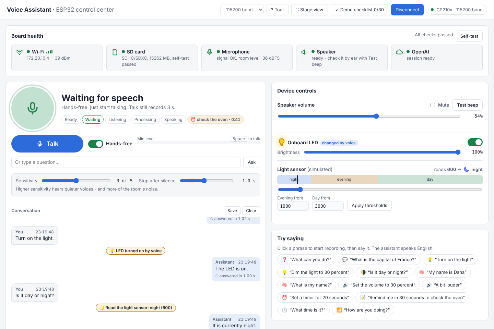

# מדריך מהיר - עוזר קולי על ESP32

קבוצה A2, קורס IoT, קיץ 2026. דף אחד כדי להפעיל את המערכת לבד.

## להתחיל

1. הלוח מחובר ב-USB למחשב, וה-hotspot של הטלפון דלוק.
2. ב-Chrome פתוח מרכז הבקרה (`tools/reply_audio_app.html`). לוחצים **Connect board** ובוחרים את ה-COM של הלוח.
3. מחכים שכל הנורות למעלה יהיו ירוקות. העוזר אומר משפט פתיחה.
4. לוחצים **Talk** (או רווח) ומדברים באנגלית, עד 3 שניות. או מדליקים **Hands-free** ופשוט מדברים.

לא מכירים את המסך? כפתור **Tour** למעלה עושה סיור קצר.

## מה לנסות

| נושא | מה להגיד | מה יקרה |
|---|---|---|
| מה הוא יודע | `What can you do?` | הוא מפרט במשפט אחד |
| שאלה כללית | `What is the capital of France?` | עונה בקול תוך כשנייה |
| אור | `Turn on the light` ואז `Dim the light to 30 percent` | ה-LED נדלק ומתעמעם, והנורה במסך זוהרת בהתאם |
| עוצמה | `Set the volume to 30 percent` ואז `A bit louder` | הסליידר זז והוא מאשר |
| תזכורת | `Remind me in 30 seconds to check the oven` | ספירה לאחור, ובסוף צפצופים, LED מהבהב ו-`Time's up - check the oven` |
| שעה | `What time is it?` | השעה והתאריך מהשעון של הלוח |
| חלק היום | `Is it day or night?` | לפי סליידר האור (מדמה חיישן) |
| זיכרון | `My name is Dana` ואז `What is my name?` | זוכר את השם |

## מה רואים במסך

- **העיגול הגדול:** מה העוזר עושה עכשיו. ירוק מוכן, אדום מקשיב, כתום חושב, כחול מדבר.
- **Conversation:** מה הוא שמע ומה ענה, תוך כמה זמן, ומה הוא הפעיל בלוח.
- **Device controls:** עוצמה, השתקה, LED וחיישן האור. ההגדרות נשמרות בלוח גם אחרי Reset.
- **Statistics:** כמה פקודות, זמני תגובה וגרף. **Summary** מציג הכל במסך מלא.
- **Stage view** (מקש F): העוזר בגדול, למי שעומד רחוק.

## אם משהו לא עובד

| מה רואים | מה עושים |
|---|---|
| נורית אדומה ב-Wi-Fi או ב-OpenAI | לבדוק את ה-hotspot וללחוץ Reset (EN) על הלוח |
| באנר אדום על ה-USB | לחבר את הכבל שוב. מרכז הבקרה מתחבר לבד |
| הוא לא הבין | לדבר קרוב יותר, באנגלית, ולבדוק בבועה מה הוא שמע |
| Hands-free נדלק מרעש | להוריד את Sensitivity, או להשתמש ב-Talk |

